# 📊 Desafio de Modelagem de Dados Relacional e Dimensional

Este desafio tem como objetivo transformar um banco de dados desnormalizado (`tb_locacao`) em um **modelo relacional normalizado** e, posteriormente, estruturá-lo em um **modelo dimensional**.

# **Etapas**

## **1. MODELO RELACIONAL**

**Código fonte do Modelo Relacional**  
[Modelo Relacional](./etapa-1/Modelagem-Relacional.sql)

---

## **2. MODELO DIMENSIONAL**

**Código fonte do Modelo Dimensional**  
[Modelo Dimensional](./etapa-2/Modelagem-Dimensional.sql)

---

## **Explicação da Normalização e do Passo a Passo para Normalizar a Tabela `tb_locacao`**

### **Normalização**

Como foi visto no curso, a normalização de tabelas é um processo de **organizar dados** em bancos de dados relacionais, com o objetivo de **minimizar redundâncias** e anomalias, garantindo **integridade** e **eficiência**. Aqui, utilizei as **formas 1NF, 2NF e 3NF** para normalizar a tabela `tb_locacao`.

---

## **Passo a Passo**

### **1. Analisando a Tabela Desnormalizada**

#### **1.1 Identificação do Problema**
Para entender a estrutura da tabela `tb_locacao`, executei o seguinte SQL no banco de dados:

```sql
SELECT * FROM tb_locacao LIMIT 10;
```

**Resultado:**  
A tabela possuía **muitas colunas repetitivas**, armazenando **dados de diferentes entidades em um único lugar**. Como evidência, segue um print da tabela original:

📌 **Evidência 1 - Estrutura da Tabela Desnormalizada**  
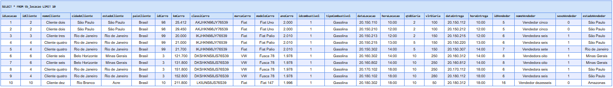

**Problemas identificados:**
- A `tb_locacao` apresentava **repetição de dados** de **cliente, carro, vendedor e tipo de combustível** em múltiplas linhas.  
- Foi possível identificar que a tabela misturava **diversas entidades**, como **CLIENTE, CARRO, COMBUSTIVEL, VENDEDOR** e os dados específicos da **LOCAÇÃO** (datas, diárias, valores etc.).

---

### **2. Separando as Entidades**
A partir da análise, separei os dados da `tb_locacao` nas seguintes tabelas:

- **CLIENTE**: `idCliente`, `nomeCliente`, `cidadeCliente`, `estadoCliente`, `paisCliente`.  
- **VENDEDOR**: `idVendedor`, `nomeVendedor`, `sexoVendedor`, `estadoVendedor`.  
- **COMBUSTIVEL**: `idCombustivel`, `tipoCombustivel`.  
- **CARRO**: `idCarro`, `classiCarro`, `marcaCarro`, `modeloCarro`, `kmCarro`, `anoCarro`, `idCombustivel` (relacionamento com COMBUSTIVEL).  
- **LOCACAO**: `idLocacao`, `dataLocacao`, `horaLocacao`, `dataEntrega`, `horaEntrega`, `qtdDiaria`, `vlrDiaria`, e FKs para `idCliente`, `idCarro` e `idVendedor`.  

---

### **3. Aplicando as Formas Normais**

- **1ª Forma Normal (1NF)**: Não havia atributos multivalorados, então bastou separar corretamente as entidades para atender à 1FN.  
- **2ª Forma Normal (2NF)**: As chaves primárias foram corretamente definidas para cada entidade, garantindo que **nenhum atributo dependesse apenas de parte da chave primária**.  
- **3ª Forma Normal (3NF)**: Eliminei **qualquer dependência transitiva**, garantindo que **cada atributo** dependesse **apenas** da chave primária da respectiva entidade.

---

# **Etapa 1 - Criação das Tabelas Normalizadas (Modelo Relacional)**

Com as entidades definidas, criei fisicamente as tabelas **CLIENTE, CARRO, COMBUSTIVEL, VENDEDOR e LOCACAO**, utilizando **constraints de PK e FK** para manter a integridade referencial.

---

## **📌 CLIENTE**
```sql
CREATE TABLE CLIENTE (
    idCliente INT PRIMARY KEY,
    nomeCliente VARCHAR(50),
    cidadeCliente VARCHAR(50),
    estadoCliente VARCHAR(50),
    paisCliente VARCHAR(50)
);
```
📌 **Evidência 2 - Criação da Tabela CLIENTE**  
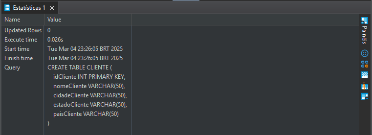

---

## **📌 COMBUSTIVEL**
```sql
CREATE TABLE COMBUSTIVEL (
    idCombustivel INT PRIMARY KEY,
    tipoCombustivel VARCHAR(30)
);
```
📌 **Evidência 3 - Criação da Tabela COMBUSTIVEL**  
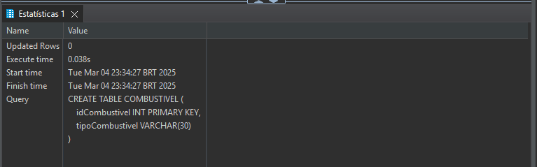

---

## **📌 CARRO**
```sql
CREATE TABLE CARRO (
    idCarro INT PRIMARY KEY,
    kmCarro INT,
    classiCarro VARCHAR(30),
    marcaCarro VARCHAR(50),
    modeloCarro VARCHAR(50),
    anoCarro INT,
    idCombustivel INT,
    FOREIGN KEY (idCombustivel) REFERENCES COMBUSTIVEL(idCombustivel)
);
```
📌 **Evidência 4 - Criação da Tabela CARRO**  
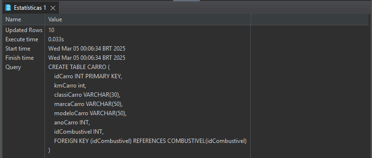

---

## **📌 VENDEDOR**
```sql
CREATE TABLE VENDEDOR (
    idVendedor INT PRIMARY KEY,
    nomeVendedor VARCHAR(50),
    sexoVendedor CHAR(1),
    estadoVendedor VARCHAR(50)
);
```
📌 **Evidência 5 - Criação da Tabela VENDEDOR**  
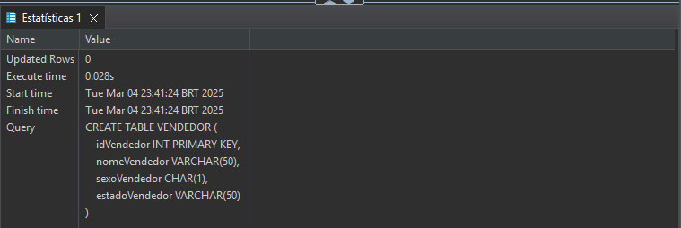

---

## **📌 LOCAÇÃO**
```sql
CREATE TABLE LOCACAO (
    idLocacao INT PRIMARY KEY,
    dataLocacao DATE,
    horaLocacao VARCHAR(5),
    dataEntrega DATE,
    horaEntrega VARCHAR(5),
    qtdDiaria INT,
    vlrDiaria DECIMAL(10,2),
    idCliente INT,
    idCarro INT,
    idVendedor INT,
    FOREIGN KEY (idCliente) REFERENCES CLIENTE(idCliente),
    FOREIGN KEY (idCarro) REFERENCES CARRO(idCarro),
    FOREIGN KEY (idVendedor) REFERENCES VENDEDOR(idVendedor)
);
```
📌 **Evidência 6 - Criação da Tabela LOCACAO**  
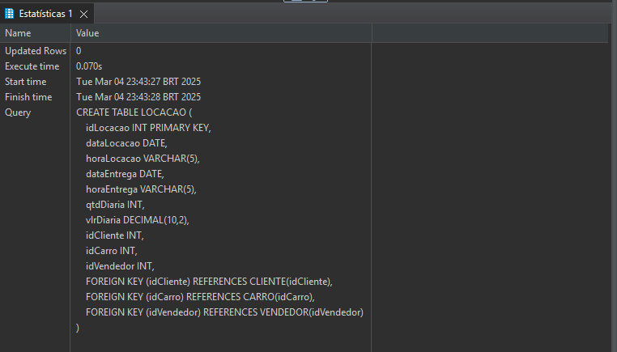

---

## **📌 Transferência de Dados da `tb_locacao` para as Tabelas Normalizadas**  
Após criar as tabelas, utilizei um script SQL para **migrar os dados** da `tb_locacao`, garantindo **eliminação de duplicatas**.  
Os comandos executados foram:
### **1️⃣ Populando a Tabela CLIENTE**  
```sql
INSERT INTO CLIENTE (idCliente, nomeCliente, cidadeCliente, estadoCliente, paisCliente)
SELECT DISTINCT idCliente, nomeCliente, cidadeCliente, estadoCliente, paisCliente
FROM tb_locacao;
```
📌 **Evidência - População da Tabela CLIENTE**  
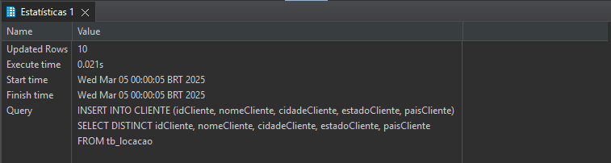

---

### **2️⃣ Populando a Tabela COMBUSTIVEL**  
```sql
INSERT INTO COMBUSTIVEL (idCombustivel, tipoCombustivel)
SELECT DISTINCT idCombustivel, tipoCombustivel
FROM tb_locacao;
```
📌 **Evidência - População da Tabela COMBUSTIVEL**  
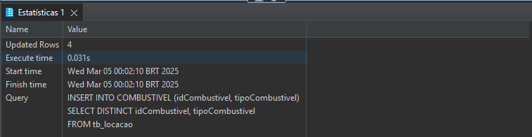

---

### **3️⃣ Populando a Tabela CARRO (AGORA COM `kmCarro`)**  
```sql
INSERT INTO CARRO (idCarro, classiCarro, marcaCarro, modeloCarro, anoCarro, kmCarro, idCombustivel)
SELECT DISTINCT idCarro, classiCarro, marcaCarro, modeloCarro, anoCarro, max (kmCarro), idCombustivel
FROM tb_locacao;
```
📌 **Evidência - População da Tabela CARRO**  
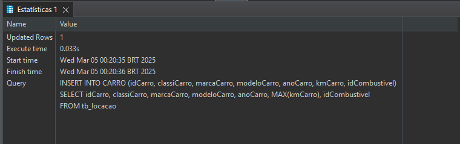

---

### **4️⃣ Populando a Tabela VENDEDOR**  
```sql
INSERT INTO VENDEDOR (idVendedor, nomeVendedor, sexoVendedor, estadoVendedor)
SELECT DISTINCT idVendedor, nomeVendedor, sexoVendedor, estadoVendedor
FROM tb_locacao;
```
📌 **Evidência - População da Tabela VENDEDOR**  
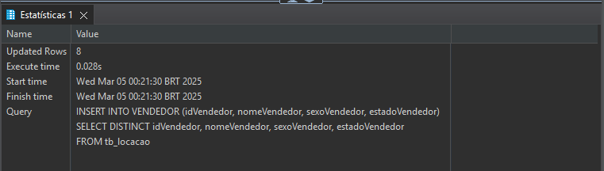

---

### **5️⃣ Populando a Tabela LOCACAO**  
```sql
INSERT INTO LOCACAO (
    idLocacao, dataLocacao, horaLocacao, dataEntrega, horaEntrega, qtdDiaria, vlrDiaria, 
    idCliente, idCarro, idVendedor
)
SELECT DISTINCT idLocacao, dataLocacao, horaLocacao, dataEntrega, horaEntrega, qtdDiaria, vlrDiaria, 
    idCliente, idCarro, idVendedor
FROM tb_locacao;
```
📌 **Evidência - População da Tabela LOCACAO**  
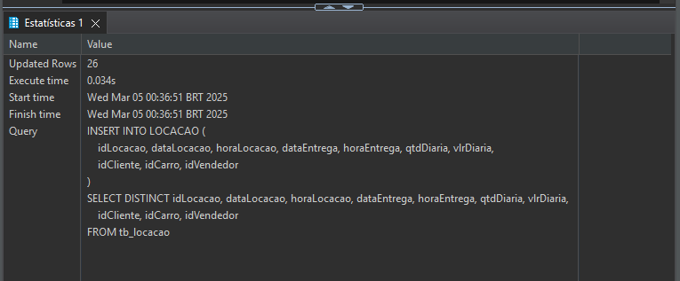

---


# **Conclusão da Normalização**
Após esse processo, a grande tabela `tb_locacao` foi **dividida** corretamente em **cinco tabelas normalizadas**. Cada entidade (**Cliente, Vendedor, Carro, Combustível**) aparece apenas **uma vez**, enquanto **LOCACAO** armazena as referências através de **chaves estrangeiras**, garantindo **integridade e evitando redundâncias**.

📌 **Evidência - Diagrama Relacional Final**  
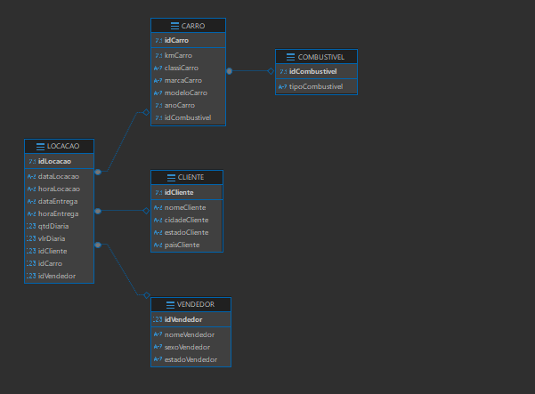

---

# **Etapa 2 - Criação do Modelo Dimendional**

Nessa etapa transformei o modelo relacional normalizado em um **modelo dimensional**, facilitando as consultas analíticas. Optei pelo **Esquema em Estrela**, em que:

1. **Dimensões** contêm atributos descritivos (Cliente, Carro, Vendedor, Tempo).  
2. **Fato** (Locacao) contém as medições (neste caso, dados de diárias, valores etc.) e as FKs apontando para as dimensões.

Nesta abordagem, **incorporei** o tipo de combustível dentro de **DimCarro** e também criei a **DimTempo** para gerenciar as datas de locação e entrega de forma detalhada (dia, mês, ano). 

---

## **1. Criando as Dimensões**

### **1.1 Dimensão Cliente**

```sql
CREATE VIEW DimCliente AS
SELECT
    c.idCliente AS idDimCliente,
    c.nomeCliente,
    c.cidadeCliente,
    c.estadoCliente,
    c.paisCliente
FROM CLIENTE c;

```

📌 **Evidência - Criação da View DimCliente**  
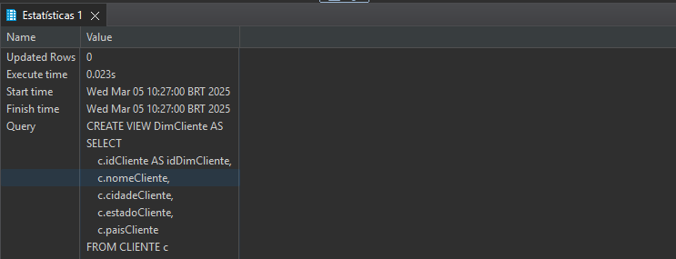

---

### **1.2 Dimensão Vendedor**

```sql
CREATE VIEW DimVendedor AS
SELECT
    v.idVendedor AS idDimVendedor,
    v.nomeVendedor,
    v.sexoVendedor,
    v.estadoVendedor
FROM VENDEDOR v;
```

📌 **Evidência - Criação da View DimVendedor**  
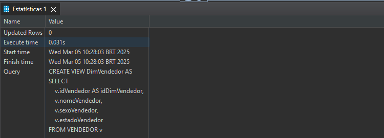

---

### **1.3 Dimensão Carro (incluindo Combustível)**

Ao invés de criar uma dimensão Combustível separada, **incorporei** o atributo `tipoCombustivel` na DimCarro, para manter um esquema estrela mais simples.

```sql
CREATE VIEW DimCarro AS
SELECT
    ca.idCarro AS idDimCarro,
    ca.classiCarro,
    ca.marcaCarro,
    ca.modeloCarro,
    ca.anoCarro,
    ca.kmCarro,
    co.tipoCombustivel
FROM CARRO ca
JOIN COMBUSTIVEL co ON ca.idCombustivel = co.idCombustivel;
```

📌 **Evidência - Criação da View DimCarro**  
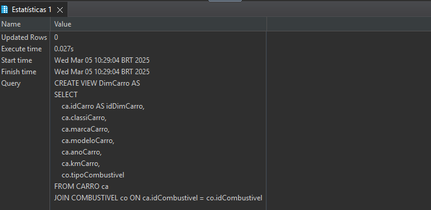

---

### **1.4 Dimensão Tempo**

```sql
CREATE VIEW DimTempo AS
SELECT DISTINCT
    l.dataLocacao AS dataCompleta,
    strftime('%d', l.dataLocacao) AS dia,
    strftime('%m', l.dataLocacao) AS mes,
    strftime('%Y', l.dataLocacao) AS ano
FROM LOCACAO l
UNION
SELECT DISTINCT
    l.dataEntrega AS dataCompleta,
    strftime('%d', l.dataEntrega) AS dia,
    strftime('%m', l.dataEntrega) AS mes,
    strftime('%Y', l.dataEntrega) AS ano
FROM LOCACAO l
WHERE l.dataEntrega IS NOT NULL;
```

📌 **Evidência - Criação da View DimTempo**  
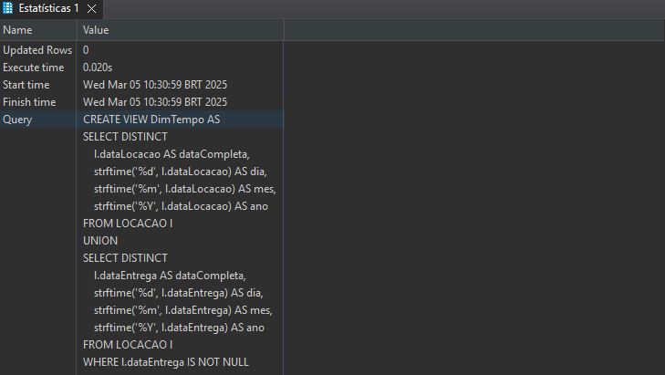

---

## **2. Criando a Tabela Fato (FactLocacao)**

A **tabela fato** contém os valores mensuráveis do processo de locação (diárias, valores etc.) e as chaves que relacionam cada locação às dimensões (Cliente, Carro, Vendedor, além de datas via `dataLocacao` e `dataEntrega` que se relacionam a DimTempo).

```sql
CREATE VIEW FactLocacao AS
SELECT
    lo.idLocacao AS idFatoLocacao,
    lo.qtdDiaria,
    lo.vlrDiaria,
    lo.dataLocacao,
    lo.horaLocacao,
    lo.dataEntrega,
    lo.horaEntrega,
    lo.idCliente AS idDimCliente,
    lo.idCarro AS idDimCarro,
    lo.idVendedor AS idDimVendedor
FROM LOCACAO lo;
```

📌 **Evidência - Criação da View FactLocacao**  
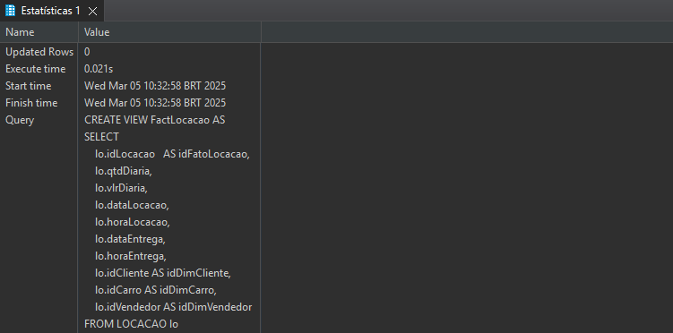

---
### **Criando os Relacionamentos no Modelo Dimensional no DBeaver**  

Após criar todas as **Views** do modelo dimensional, precisei configurar **manualmente** os **relacionamentos** no **DBeaver**.  
O motivo disso é que, **diferente das tabelas normais**, as Views **não possuem chaves estrangeiras explícitas** no banco de dados.  
Por isso, precisei **conectar** cada dimensão à tabela fato manualmente dentro do **editor de diagramas do DBeaver**.  

---


### **1️⃣ Relacionamento entre FactLocacao e DimCliente**  

#### **Passo a Passo**  
1. No **DBeaver**, fui até o **Database Navigator** e localizei a **FactLocacao**.  
2. Abri o **View Diagram** e **adicionei a DimCliente** ao diagrama.  
3. Arrastei o campo `idDimCliente` de **FactLocacao** e conectei ao campo `idDimCliente` da **DimCliente**.  

📌 **Evidência - Relacionamento FactLocacao x DimCliente**  
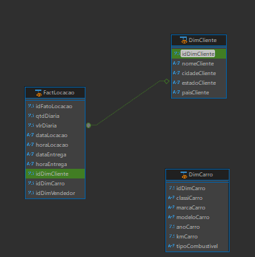  

---

### **2️⃣ Relacionamento entre FactLocacao e DimVendedor**  

#### **Passo a Passo**  
1. No **View Diagram**, adicionei a **DimVendedor**.  
2. Arrastei `idDimVendedor` da **FactLocacao** e conectei ao campo correspondente na **DimVendedor**.  

📌 **Evidência - Relacionamento FactLocacao x DimVendedor**  
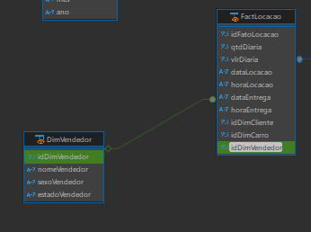  

---

### **3️⃣ Relacionamento entre FactLocacao e DimCarro**  

#### **Passo a Passo**  
1. No **View Diagram**, adicionei a **DimCarro**.  
2. Arrastei `idDimCarro` da **FactLocacao** e conectei ao campo `idDimCarro` da **DimCarro**.  

📌 **Evidência - Relacionamento FactLocacao x DimCarro**  
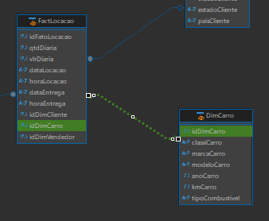  

---

### **4️⃣ Relacionamento da DimTempo com a Fato**  

Na **FactLocacao**, eu tenho duas datas principais que preciso considerar:  
  **dataLocacao** (quando o cliente alugou o carro)  
  **dataEntrega** (quando o cliente devolveu o carro)  

No entanto, o **DBeaver não permite dois relacionamentos diretos entre FactLocacao e DimTempo**, então precisei encontrar uma solução para contornar essa limitação. A abordagem que escolhi foi manter o relacionamento direto **apenas com dataLocacao** e, quando necessário, utilizar **dois JOINs distintos** nas consultas para diferenciar as duas datas.  

---

📌 **Relacionamento Criado no DBeaver**  

No **DBeaver**, configurei o relacionamento **apenas entre FactLocacao e DimTempo pela dataLocacao**. Dessa forma, consigo visualizar as conexões sem que a ferramenta me impeça de trabalhar com as datas de entrega.  

📌 **Como Lidar com a Data de Entrega nas Consultas?**  

Como o **DBeaver só permite um relacionamento direto**, minha solução foi utilizar **dois JOINs distintos** nas consultas SQL, um para **dataLocacao** e outro para **dataEntrega**, atribuindo **"nomes" diferentes** para a DimTempo.  

---


## **Resultado Final - Esquema Dimensional com Todos os Relacionamentos**  

Após configurar todos os relacionamentos, o **diagrama dimensional** ficou assim no DBeaver:  

📌 **Evidência - Diagrama Completo com Relacionamentos no DBeaver**  
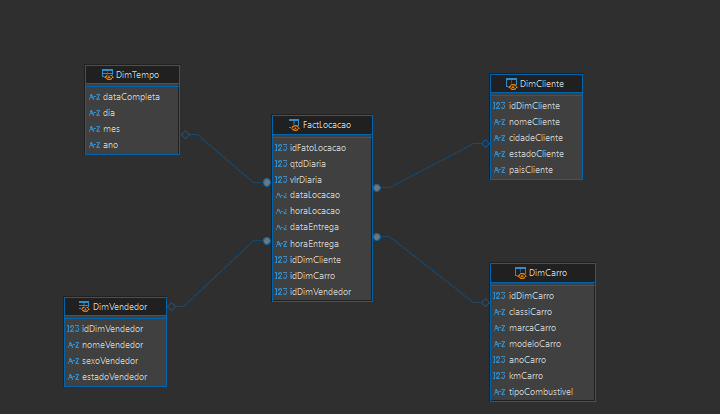  

Agora todas as Views **estão conectadas corretamente**, permitindo realizar consultas relacionais sem dificuldades.

---


## **Estrutura Resultante**

Com essas **Views**, construí um **Esquema Estrela**:  
- **DimCliente**, **DimVendedor**, **DimCarro**, **DimTempo**  
- **FactLocacao** no centro, referenciando as dimensões pelos IDs (para Tempo, usamos as colunas `dataLocacao` e `dataEntrega` em join com `DimTempo.dataCompleta`).

---

## 📌 Conclusão  

Após a modelagem, chegamos a um banco de dados otimizado para análise, seguindo as seguintes diretrizes:  

**1️⃣Dimensões Criadas** → Cliente, Vendedor, Carro (com combustível embutido) e Tempo.  
**2️⃣ Fato Definido** → A tabela FactLocacao armazena as transações de locação e se relaciona com as dimensões por `idCliente`, `idCarro`, `idVendedor` e datas (`dataLocacao` e `dataEntrega` → DimTempo).  
**3️⃣Esquema Estrela** → Cada dimensão foi mantida em **Views**, simplificando as consultas e eliminando redundâncias.  
**4️⃣Dimensão Tempo** → Implementada para análises cronológicas detalhadas, permitindo segmentação por dia, mês e ano.  

Com isso, o **modelo dimensional** está completamente estruturado, garantindo uma base eficiente para consultas analíticas.  

🔹 **A Dimensão Tempo foi integrada corretamente para análises temporais.**  
🔹 **O tipo de combustível foi incorporado na DimCarro, respeitando o Esquema Estrela.**  

✅ **Finalizo assim o processo de normalização da `tb_locacao`**, garantindo **1NF, 2NF e 3NF**, e a transformação em um **Modelo Dimensional funcional via Views**.   

 


