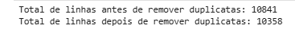
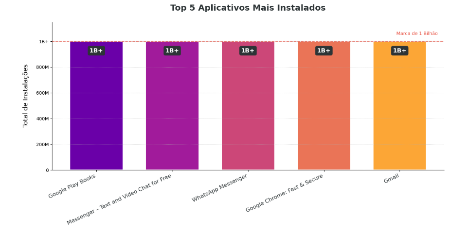
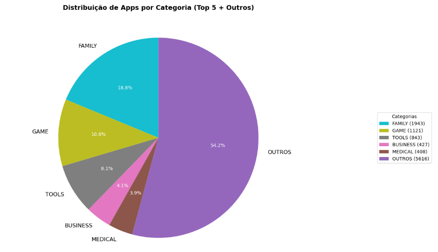
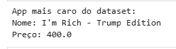
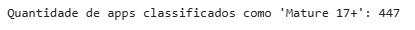
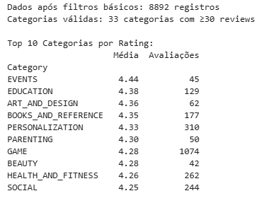
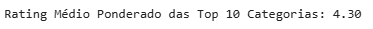
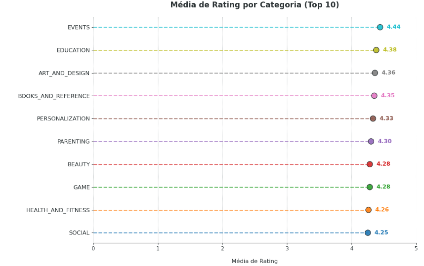
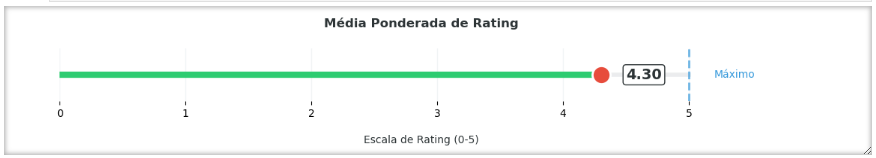

# Desafio Google Play Store

## 📌 Introdução

Este projeto detalha minha solução para o **desafio de análise exploratória dos dados da Google Play Store**, realizado como parte das atividades propostas. Através do uso das bibliotecas **Pandas** e **Matplotlib** em Python, conduzi diversas análises sobre o dataset disponibilizado, abordando desde a limpeza inicial dos dados até a criação de gráficos para uma visualização intuitiva e clara dos resultados.

Além deste documento, todo o processo desenvolvido está registrado no arquivo Jupyter Notebook: [**desafio.ipynb**](../Desafio/etapa-1/desafio.ipynb), onde cada etapa contém códigos detalhados e explicações adicionais em formato Markdown, permitindo uma compreensão passo a passo de todas as decisões técnicas tomadas durante o desenvolvimento. 

Este arquivo inclui:

- Limpeza e preparação dos dados;
- Cálculos e indicadores estatísticos;
- Gráficos explicativos das análises realizadas.
---

## Etapa 1 – Configuração do Ambiente

**Objetivo:** Importar bibliotecas e configurar a exibição de gráficos.  
**Decisões:**  
- Utilizei `pandas` para manipulação de dados e `matplotlib` para visualizações.  
- `%matplotlib inline` garante que os gráficos sejam renderizados diretamente no notebook, facilitando a visualização durante a análise.  

**Código:**
```python
import pandas as pd
import matplotlib.pyplot as plt
%matplotlib inline  # Exibe gráficos 
```

---

## Etapa 2 – Leitura do CSV e Remoção de Duplicatas

**Objetivo:** Garantir dados limpos para análise.  
**Decisões:**  
- Usei `pd.read_csv` para ler o arquivo `googleplaystore.csv`.  
- `drop_duplicates` remove linhas repetidas, evitando distorções na análise.  
- Exibi o número de linhas antes e depois da remoção para confirmar a limpeza dos dados.

**Código:**
```python
df = pd.read_csv('googleplaystore.csv')
print("Total de linhas antes de remover duplicatas:", len(df))

df.drop_duplicates(inplace=True)
print("Total de linhas depois de remover duplicatas:", len(df))
```

**Evidência:**  
  

---

## Etapa 3 – Gráfico de Barras: Top 5 Apps por Instalações

**Objetivo:** Identificar os apps mais populares.  
**Decisões:**  
- Converti a coluna `Installs` para numérico, removendo caracteres não numéricos (`+`, `,`).  
- Usei cores gradientes (`plasma`) para diferenciar visualmente as barras.  
- Adicionei uma linha de referência em 1 bilhão para destacar apps de alto impacto.  
- Rótulos customizados foram adicionados para facilitar a leitura dos valores.

**Código:**
```python
df['Installs'] = df['Installs'].astype(str).str.replace('[+,]', '', regex=True)
df['Installs'] = pd.to_numeric(df['Installs'], errors='coerce')

# Seleção dos 5 apps com maior número de instalações
top_cinco = df.nlargest(5, 'Installs').sort_values('Installs', ascending=False)

plt.figure(figsize=(13, 7))
eixo = plt.gca()
n_categorias = len(top_cinco)
valores_cor = [0.2 + (0.6/(n_categorias-1))*i for i in range(n_categorias)] if n_categorias > 1 else [0.5]
cores = plt.cm.plasma(valores_cor)

# Gráfico de barras
barras = eixo.bar(
    top_cinco['App'],
    top_cinco['Installs'],
    color=cores,
    width=0.7,
    edgecolor='white',
    linewidth=1.5
)

# Função para formatar os valores de instalações
def formatar_instalacoes(valor):
    if valor >= 1e9:
        return f'1B+' if valor == 1e9 else f'{valor/1e9:.1f}B'
    elif valor >= 1e6:
        return f'{valor/1e6:.0f}M'
    return f'{int(valor):,}'

# Adiciona rótulos customizados nas barras
for barra in barras:
    altura = barra.get_height()
    eixo.text(
        barra.get_x() + barra.get_width()/2,
        altura * 0.95,
        formatar_instalacoes(altura),
        ha='center',
        va='top',
        color='white',
        fontsize=13,
        fontweight='bold',
        bbox=dict(boxstyle="round,pad=0.3", facecolor='#2d3436', edgecolor='none')
    )

# Ajusta o limite superior do eixo y
max_instalacoes = top_cinco['Installs'].max()
eixo.set_ylim(0, max_instalacoes * 1.15)
eixo.yaxis.set_major_formatter(plt.FuncFormatter(lambda x, _: formatar_instalacoes(x)))

# Configura título, rótulos e estilo do gráfico
eixo.set_title('Top 5 Aplicativos Mais Instalados', pad=25, fontsize=18, fontweight='bold', color='#2d3436')
eixo.set_ylabel('Total de Instalações', fontsize=14, labelpad=15)
eixo.set_xlabel('')
eixo.spines['top'].set_visible(False)
eixo.spines['right'].set_visible(False)
eixo.grid(axis='y', linestyle=':', alpha=0.7)
plt.xticks(rotation=25, ha='right', fontsize=12, color='#2d3436')

# Linha de referência para 1 bilhão
eixo.axhline(y=1e9, color='#e74c3c', linestyle='--', alpha=0.7, lw=1.5)
eixo.text(
    len(top_cinco)-0.5,
    1e9 * 1.05,
    'Marca de 1 Bilhão',
    color='#e74c3c',
    fontsize=10,
    ha='right'
)

plt.tight_layout()
plt.show()
```

**Explicação do Código:**  
- `str.replace` remove os caracteres `+` e `,` da coluna `Installs`, permitindo a conversão para números.  
- `nlargest(5, 'Installs')` seleciona os 5 apps com mais instalações.  
- `plt.cm.plasma` gera cores distintas para cada barra, facilitando a visualização.  
- `plt.axhline` adiciona uma linha horizontal em 1 bilhão para destacar apps com alto volume de instalações.

**Evidência:**  
 

---

## Etapa 4 – Gráfico de Pizza: Distribuição por Categoria (Top 5 + OUTROS)

**Objetivo:** Mostrar a predominância de categorias.  
**Decisões:**  
- Agrupei categorias menos frequentes em "OUTROS" para evitar poluição visual.  
- Usei `autopct='%1.1f%%'` para exibir porcentagens diretamente no gráfico.  
- Ajustei o ângulo inicial (`startangle=140`) para melhorar a disposição das fatias.

**Código:**
```python
# Contagem de apps por categoria
contagem_categoria = df['Category'].value_counts()

# Seleciona as 5 categorias mais frequentes
top5_categorias = contagem_categoria.head(5)

# Agrupa as demais categorias como 'OUTROS'
contagem_outros = contagem_categoria[5:].sum()
contagem_combinada = pd.concat([top5_categorias, pd.Series({'OUTROS': contagem_outros})])

# Gráfico de pizza
plt.figure(figsize=(12, 8))
fatias, textos, textos_auto = plt.pie(
    contagem_combinada,
    labels=contagem_combinada.index,
    autopct='%1.1f%%',
    startangle=90,
    colors=plt.get_cmap('tab10_r').colors
)

# Ajusta o tamanho das fontes
for texto in textos:
    texto.set_fontsize(12)
for texto_auto in textos_auto:
    texto_auto.set_fontsize(10)
    texto_auto.set_color('white')

# Legenda com rótulos e quantidades
legendas = [f'{rotulo} ({quantidade})' for rotulo, quantidade in zip(contagem_combinada.index, contagem_combinada)]
plt.legend(legendas, title="Categorias", loc="center right", bbox_to_anchor=(1.1, 0, 0.5, 1))

plt.title('Distribuição de Apps por Categoria (Top 5 + Outros)', fontsize=14, fontweight='bold')
plt.tight_layout()
plt.show()
```

**Explicação do Código:**  
- `value_counts()` conta a frequência de cada categoria.  
- `head(5)` seleciona as 5 categorias mais frequentes; o restante é somado em "OUTROS".  
- `plt.pie` cria o gráfico de pizza, com porcentagens exibidas diretamente nas fatias.

**Evidência:**  
 

---

## Etapa 5 – Identificação do App Mais Caro

**Objetivo:** Encontrar o app com maior preço.  
**Decisões:**  
- Converti a coluna `Price` para float, removendo o símbolo `$`.  
- Usei `idxmax()` para encontrar o índice do valor máximo.  
- Exibi o nome e o preço do app mais caro.

**Código:**
```python
df['Price'] = df['Price'].astype(str).str.replace('$', '', regex=False)
df['Price'] = pd.to_numeric(df['Price'], errors='coerce')

idx_max_price = df['Price'].idxmax()  # índice do valor máximo
app_mais_caro = df.loc[idx_max_price]

print("App mais caro do dataset:")
print("Nome:", app_mais_caro['App'])
print("Preço:", app_mais_caro['Price'])
```

**Evidência:**  
 

---

## Etapa 6 – Contagem de Apps "Mature 17+"

**Objetivo:** Filtrar apps com classificação específica.  
**Decisões:**  
- Usei `str.strip()` para evitar erros por espaços em branco.  
- Filtrei a coluna `Content Rating` para valores exatamente iguais a "Mature 17+".  
- `len()` retorna a contagem exata de apps filtrados.

**Código:**
```python
mature_apps = df[
    (df['Content Rating'].notna()) & 
    (df['Content Rating'].str.strip() == 'Mature 17+')
]
print(f"Quantidade de apps classificados como 'Mature 17+': {len(mature_apps)}")
```

**Evidência:**  
 

---

## Etapa 7 – Top 10 Apps por Número de Reviews

**Objetivo:** Listar apps mais revisados.  
**Decisões:**  
- Converti `Reviews` para numérico e removi valores inválidos (`dropna`).  
- Ordenei em ordem decrescente e removi duplicatas para garantir unicidade.  
- Exibi os 10 primeiros apps com mais reviews.

**Código:**
```python
# Converter 'Reviews' para numérico e remover valores inválidos
df_clean = df.copy()
df_clean['Reviews'] = pd.to_numeric(df_clean['Reviews'], errors='coerce')
df_clean = df_clean.dropna(subset=['Reviews']).reset_index(drop=True)

# Verificar se o dataset está vazio após a limpeza
if df_clean.empty:
    print("Dataset vazio após remoção de valores inválidos!")
    exit()

# Ordenar por reviews e remover duplicatas
df_processed = df_clean.sort_values(by='Reviews', ascending=False).drop_duplicates(subset=['App'], keep='first')

# Selecionar top 10
top_10 = df_processed.head(10)

# Verificar se há pelo menos 10 apps válidos
if len(top_10) < 10:
    print(f"Aviso: Apenas {len(top_10)} apps válidos encontrados!")

# Exibir resultados
print("\nTop 10 Apps por Número de Reviews".center(50, '-'))
print(top_10[['App', 'Reviews']].to_string(index=False, justify='left', formatters={'Reviews': lambda x: f"{x:,}"}))
```

**Evidência:**  
 
---

## Etapa 8 – Cálculos Extras: Análise de Ratings

### Parte 1: Análise de Ratings por Categoria  
**Objetivo:** Calcular a média de rating por categoria, filtrando categorias com amostra mínima.  
**Decisões:**  
- Filtrei categorias com pelo menos 30 reviews para evitar distorções por amostras pequenas.  
- Usei `groupby` e `agg` para calcular média e contagem.  
- Ordenei as categorias por rating médio e selecionei as top 10.

**Código:**
```python
def analyze_ratings(df: pd.DataFrame, min_reviews: int = 50) -> pd.DataFrame:
    # Verificar colunas necessárias
    if not {'Rating', 'Category'}.issubset(df.columns):
        print("Erro: Colunas 'Rating' ou 'Category' não encontradas")
        return pd.DataFrame()

    # Converter e validar ratings
    df = df.copy()
    df['Rating'] = pd.to_numeric(df['Rating'], errors='coerce')
    
    # Aplicar filtros sequencialmente
    valid_ratings = df.dropna(subset=['Rating'])  # Remove valores NaN em 'Rating'
    valid_ratings = valid_ratings.query('1 <= Rating <= 5')  # Filtra ratings entre 1 e 5
    
    print(f"Dados após filtros básicos: {len(valid_ratings)} registros")
    
    # Filtrar categorias com amostra mínima
    valid_categories = valid_ratings.groupby('Category').filter(lambda x: len(x) >= min_reviews)
    print(f"Categorias válidas: {valid_categories['Category'].nunique()} categorias com ≥{min_reviews} reviews")

    if valid_categories.empty:
        print("Nenhuma categoria atende aos critérios mínimos")
        return pd.DataFrame()

    # Calcular estatísticas
    result = (
        valid_categories
        .groupby('Category')['Rating']
        .agg(Média='mean', Avaliações='count')  # Calcula média e contagem
        .sort_values('Média', ascending=False)  # Ordena por rating médio
        .head(10)  # Seleciona as top 10 categorias
        .round(2)  # Arredonda para 2 casas decimais
    )

    return result

if not df.empty:
    resultado = analyze_ratings(df, min_reviews=30)  # Reduza o mínimo para teste
    
    if not resultado.empty:
        print("\nTop 10 Categorias por Rating:")
        print(resultado.to_string())
    else:
        print("\nNenhum resultado encontrado após os filtros")
else:
    print("DataFrame vazio")
```

**Evidência:**  
 

### Parte 2: Rating Médio Ponderado  
**Objetivo:** Calcular um rating único que considera o volume de reviews.  
**Decisões:**  
- Multipliquei a média de rating de cada categoria pelo número de reviews.  
- Somei esses valores e dividi pelo total de reviews para obter o rating ponderado.  
- Exibi o resultado arredondado para duas casas decimais.

**Código:**
```python
# Cálculo do Rating Médio Ponderado
weighted_sum = 0
total_count = 0

for idx, row in resultado.iterrows():
    weighted_sum += row['Média'] * row['Avaliações']
    total_count += row['Avaliações']

if total_count > 0:
    weighted_avg = weighted_sum / total_count
    weighted_avg = round(weighted_avg, 2) 
    print(f"Rating Médio Ponderado das Top 10 Categorias: {weighted_avg:.2f}")
else:
    print("Sem avaliações nas categorias selecionadas.")
```

**Evidência:**  
 

---

## Etapa 9 – Visualizações Gráficas para os Cálculos

### Gráfico 1: Média de Ratings por Categoria (Top 10)  
**Objetivo:** Comparar visualmente as médias.  
**Decisões:**  
- Usei um gráfico de pontos (`plt.scatter`) para destacar cada categoria.  
- O tamanho dos pontos é proporcional ao número de apps na categoria.  
- Cores vibrantes melhoram a diferenciação.

**Código:**
```python
if resultado.empty:
    print("Nenhum resultado disponível para plotagem.")
else:
    # Preparar dados
    top10 = resultado['Média'].sort_values(ascending=True)
    
    plt.figure(figsize=(12, 8), facecolor='white')
    
    colors = [
        '#1f77b4',  # Azul
        '#ff7f0e',  # Laranja
        '#2ca02c',  # Verde
        '#d62728',  # Vermelho
        '#9467bd',  # Roxo
        '#8c564b',  # Marrom
        '#e377c2',  # Rosa
        '#7f7f7f',  # Cinza
        '#bcbd22',  # Verde-oliva
        '#17becf'   # Ciano
    ]
    marker_size = 140 
    
    # Criar dot plot
    plt.scatter(
        y=top10.index,
        x=top10.values,
        s=marker_size,
        c=colors[:len(top10)],  
        edgecolors='#2d3436',  
        linewidths=1.2,  
        zorder=3,
        alpha=0.9  
    )
    
    # Linhas de referência
    for i, (cat, val) in enumerate(top10.items()):
        plt.hlines(y=cat, xmin=0, xmax=val, 
                 colors=colors[i], 
                 linestyles='--', 
                 alpha=0.7,
                 linewidth=2)  
        
        # Texto 
        plt.text(val + 0.1, cat, f'{val:.2f}',
               va='center',
               fontsize=12,  
               fontweight='bold',
               color=colors[i],
               bbox=dict(facecolor='white', edgecolor='none', alpha=0.8))  
    
    # Configurações
    plt.title('Média de Rating por Categoria (Top 10)', 
         fontsize=16, pad=20, fontweight='bold', color='#2d3436')
    plt.xlabel('Média de Rating', fontsize=12, labelpad=15, color='#2d3436')
    plt.xlim(0, 5)
    
    # Ajustes de eixo
    ax = plt.gca()
    ax.spines[['top', 'right', 'left']].set_visible(False)
    ax.grid(axis='x', linestyle=':', color='#636e72', alpha=0.6)
    ax.tick_params(axis='x', colors='#2d3436', labelsize=11)
    ax.tick_params(axis='y', colors='#2d3436', labelsize=12)
    
    # Fundo 
    plt.gcf().set_facecolor('white')
    
    plt.tight_layout()
    plt.show()
```

**Evidência:**  
 

### Gráfico 2: Rating Médio Ponderado  
**Objetivo:** Exibir o indicador único em relação à escala máxima (5.0).  
**Decisões:**  
- Para representar a média ponderada, utilizei um gráfico de linha simples, destacando o valor encontrado com um marcador para facilitar a visualização do resultado em relação ao valor máximo.
- Usei uma barra horizontal para simular um "medidor".  
- Cores gradientes indicam proximidade do valor máximo.  
- Adicionei uma linha de referência em 5.0 para contextualizar o resultado.

**Código:**
```python
def plot_weighted_rating_line(weighted_avg: float, reference_value: float = 5.0) -> None:

    fig, ax = plt.subplots(figsize=(10, 2), facecolor='white')
    
    # Validação de dados
    if not (0 <= weighted_avg <= reference_value):
        raise ValueError(f"Valor deve estar entre 0 e {reference_value}")
    
    # Cores modernas
    colors = {
        'line': '#2ecc71',
        'marker': '#e74c3c',
        'text': '#2d3436',
        'reference': '#3498db'
    }
    
    # Linha de base
    ax.plot([0, reference_value], [0, 0], color='#bdc3c7', lw=4, alpha=0.3, zorder=1)
    
    # Linha principal com marcador
    ax.plot([0, weighted_avg], [0, 0], color=colors['line'], lw=6, solid_capstyle='round', zorder=2)
    ax.scatter(weighted_avg, 0, s=300, color=colors['marker'], edgecolor='white', lw=2, zorder=3)
    
    # Texto flutuante
    ax.text(weighted_avg + 0.2, 0, f'{weighted_avg:.2f}', 
            va='center', ha='left', color=colors['text'], 
            fontsize=14, fontweight='bold',
            bbox=dict(facecolor='white', edgecolor=colors['text'], boxstyle='round,pad=0.2'))
    
    # Linha de referência
    ax.axvline(reference_value, color=colors['reference'], ls='--', lw=2, alpha=0.7)
    ax.text(reference_value + 0.2, 0, 'Máximo', 
            va='center', color=colors['reference'], fontsize=10)
    
    # Configurações do eixo
    ax.set_xlim(0, reference_value * 1.15)
    ax.set_ylim(-0.5, 0.5)
    ax.set_yticks([])
    ax.spines[['top','right','left','bottom']].set_visible(False)
    
    # Rótulos e título
    ax.set_xlabel('Escala de Rating (0-5)', fontsize=10, labelpad=15, color=colors['text'])
    ax.set_title('Média Ponderada de Rating', 
                 fontsize=12, pad=20, fontweight='bold', color=colors['text'])
    
    # Grid personalizado
    ax.xaxis.grid(True, color='#ecf0f1', lw=1, linestyle='-', alpha=0.7)
    
    plt.tight_layout()
    plt.show()

plot_weighted_rating_line(weighted_avg)
```

**Evidência:**  
 

---

## Conclusão

**Requisitos Atendidos:**  
1. ✅ **Dados Limpos:** Remoção de duplicatas.  
2. ✅ **Visualizações Obrigatórias:** Gráficos de barras e pizza.  
3. ✅ **Filtragens e Cálculos:** App mais caro, "Mature 17+", top 10 reviews.  
4. ✅ **Cálculos Extras:** Análise de ratings por categoria e rating ponderado.  
5. ✅ **Gráficos Adicionais:** Dot plot (gráfico de ponto) e medidor de rating (gráfico de linha).  


