# Instrução  

Este arquivo será o relato da minha entrega. Neste arquivo, faço a organização geral ao longo da Sprint. Aqui serão apresentadas as seções de aprendizado, exercícios e evidências da execução dos códigos.  

---

# Resumo  

Durante esta Sprint, aprofundei meus conhecimentos em **Python**, focando em manipulação de arquivos, funções de alta ordem, expressões lambda e programação funcional. Trabalhei com arquivos **CSV, JSON e TXT**, aplicando diferentes técnicas para leitura, escrita e processamento eficiente dos dados. Além disso, explorei conceitos avançados de **list comprehension**, **funções anônimas (lambda)** e a aplicação de **reduce, map, filter e zip** para resolver problemas de forma elegante e otimizada.  

Também desenvolvi habilidades na manipulação de **dicionários e listas**, organizando dados de maneira eficiente e aplicando transformações em grandes volumes de informação. Além disso, realizei um projeto prático de **ETL (Extract-Transform-Load)**, utilizando Python puro para processar e transformar dados de forma estruturada e eficiente a partir de arquivos CSV.

Como desafio principal da Sprint, realizei um projeto utilizando as bibliotecas **Pandas** e **Matplotlib**, onde processei e analisei dados do arquivo `googleplaystore.csv`. Neste desafio, foram criados gráficos e análises exploratórias que permitiram uma compreensão visual detalhada dos dados, identificando padrões e insights relevantes. 

---

# Exercícios  

Os exercícios foram organizados nas pastas abaixo, contendos os arquivos que seguem as instruções do enunciado e aplicando as técnicas aprendidas. Cada arquivo contém os respectivos códigos e seus enunciados.  

📌 **Exercícios Parte 1**  
👉 [Acessar Pasta](Exercicios/Parte_1)  

📌 **Exercícios Parte 2**  
👉 [Acessar Pasta](Exercicios/Parte_2)  

📌 **Exercícios Parte 3**  
👉 [Acessar Pasta](Exercicios/Parte_3)  

📌 **Exercícios Parte 4 - ETL**  
👉 [Acessar Pasta](Exercicios/Parte_4_ETL)  

# Desafio
👉 [Acessar Pasta](Desafio/etapa-1) 

Os arquivos foram organizados de forma a facilitar a navegação e a compreensão dos exercícios e do desafio resolvido.  

---

# Evidências  

Abaixo estão as evidências da execução dos exercícios. Cada imagem contém o resultado obtido após rodar os códigos no interpretador Python.  

📌 **E01 -**  
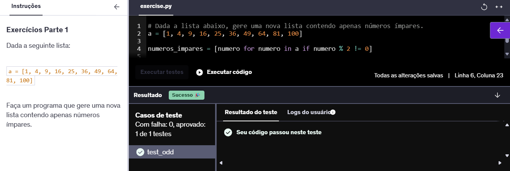  

📌 **E02 -**  
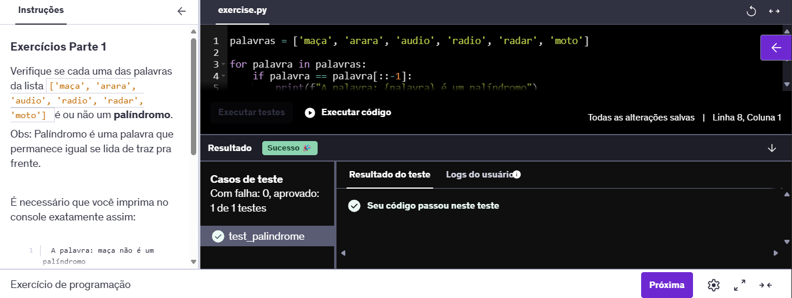  

📌 **E03 -**  
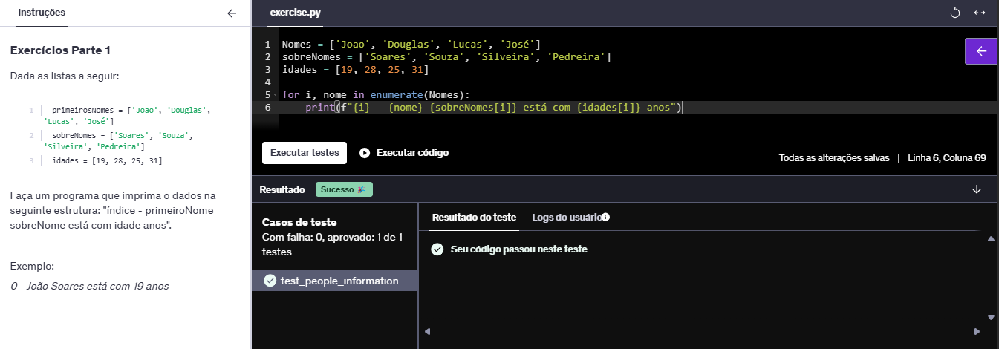  

📌 **E04 -**  
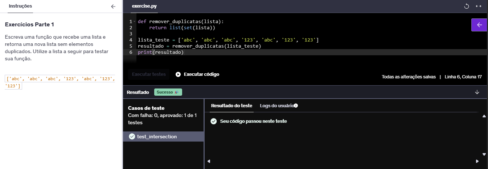  

📌 **E05 -**  
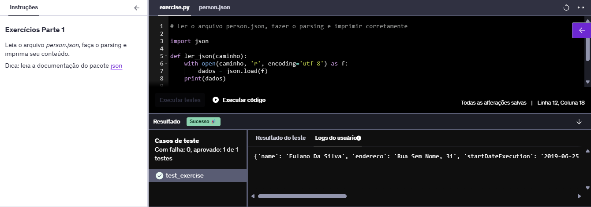  

📌 **E06 -**  
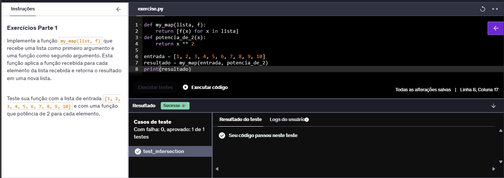  

📌 **E07 -**  
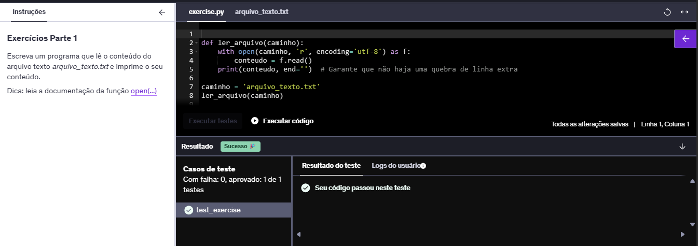  

📌 **E08 -**  
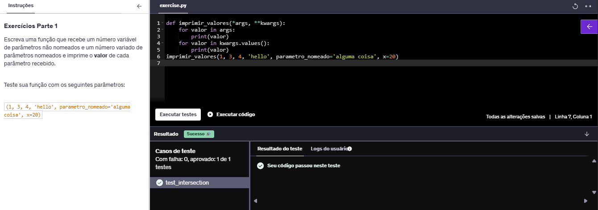  

📌 **E09 -**  
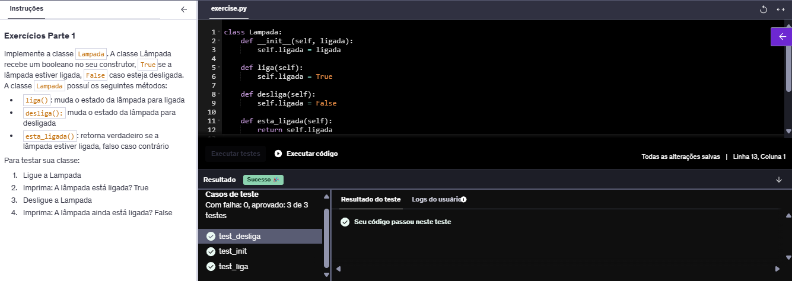  

📌 **E10 -**  
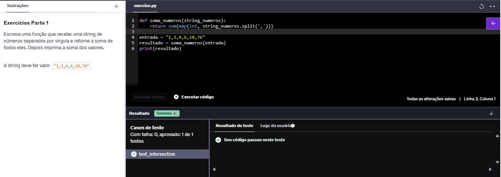  

📌 **E11 -**  
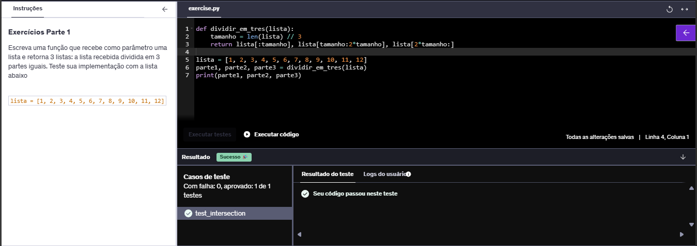  

📌 **E12 -**  
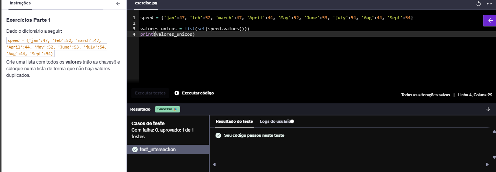  

📌 **E13 -**  
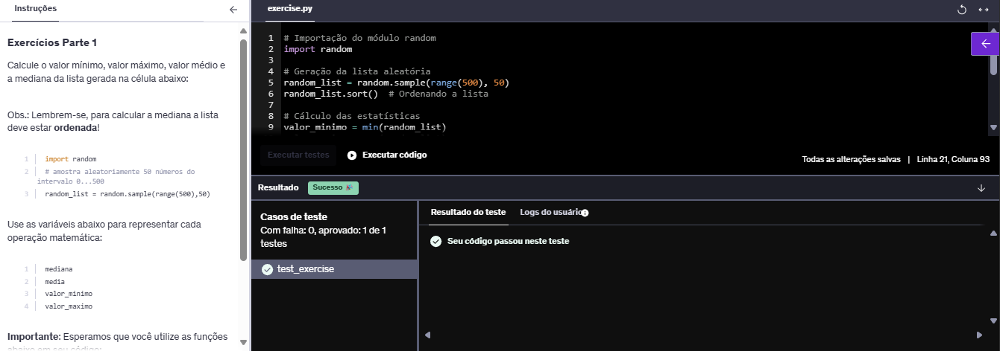  

📌 **E14 -**  
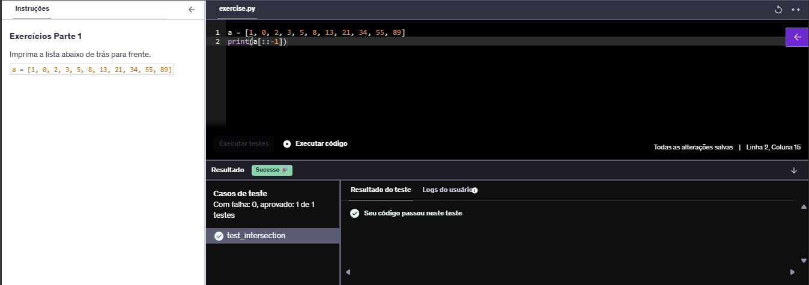  

📌 **E15 -**  
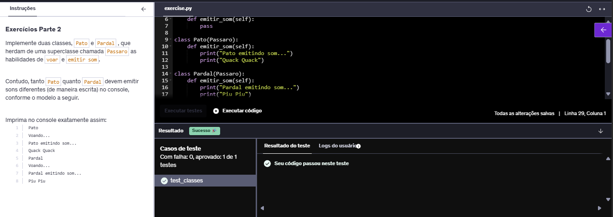  

📌 **E16 -**  
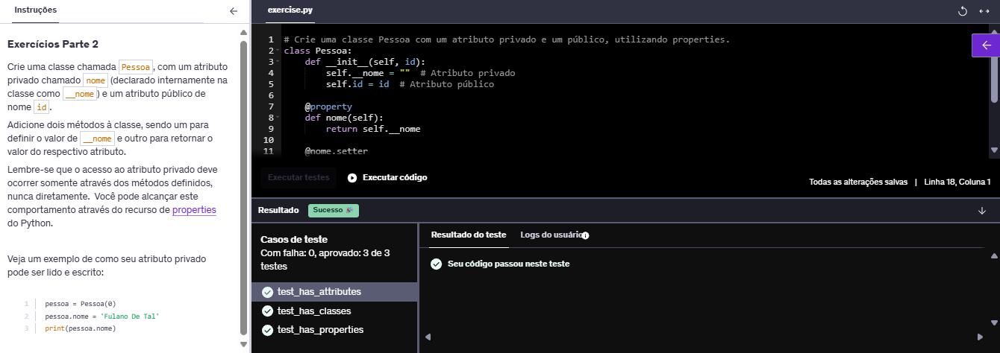  

📌 **E17 -**  
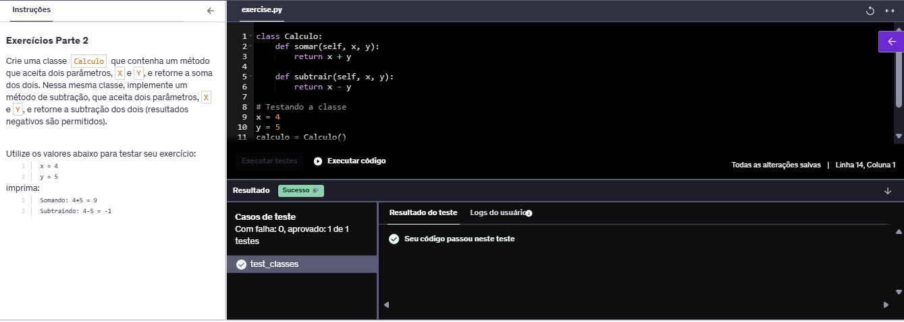  

📌 **E18 -**  
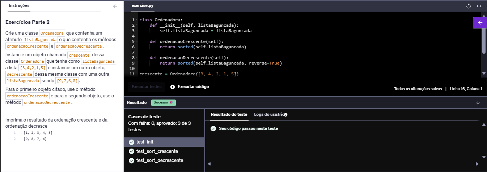  

📌 **E19 -**  
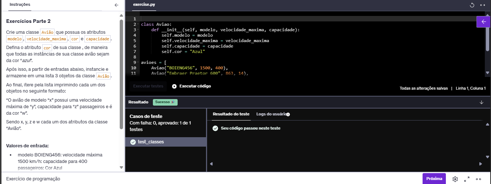  

📌 **E20 -**  
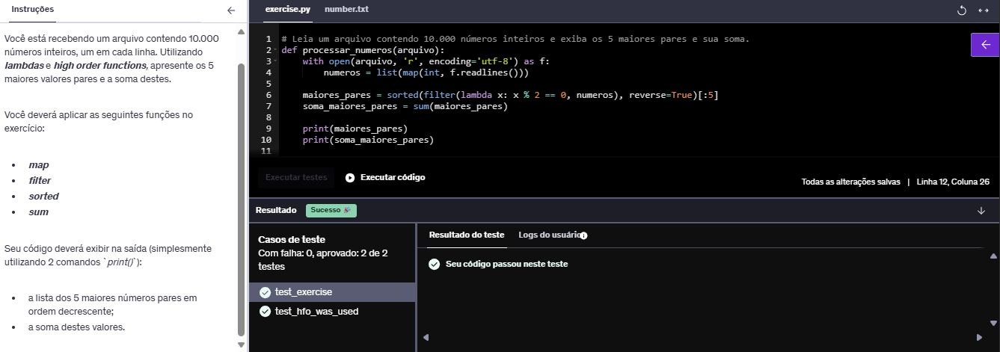  

📌 **E21 -**  
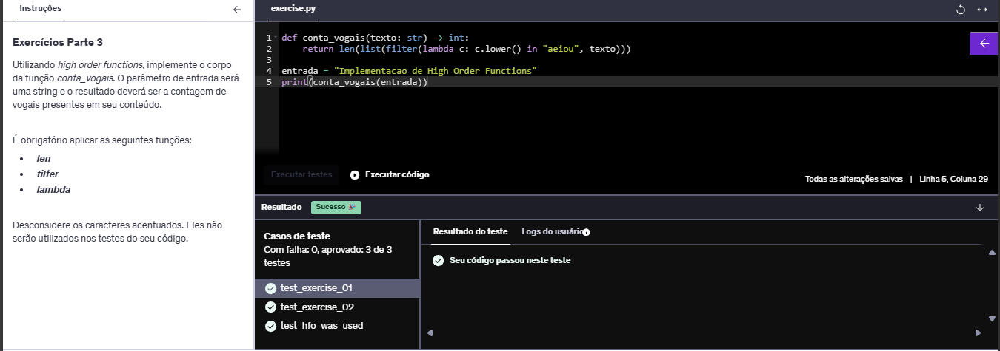  

📌 **E22 -**  
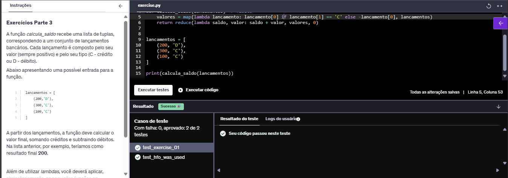  

📌 **E23 -**  
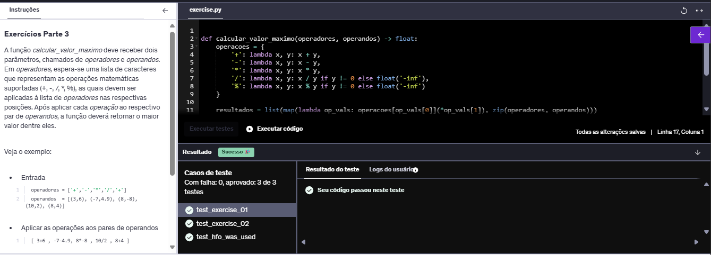  

📌 **E24 -**  
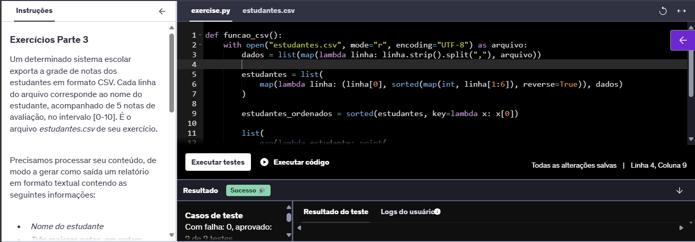  

📌 **E25 -**  
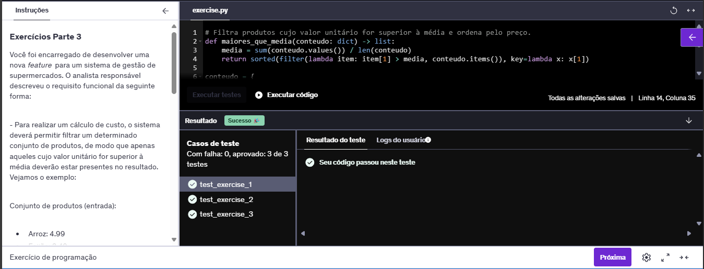  

📌 **E26 -**  
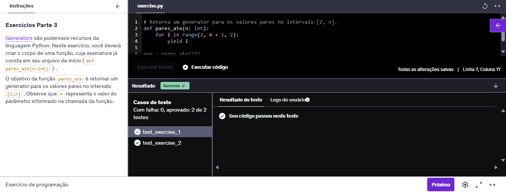  

Essas evidências demonstram que os códigos foram executados corretamente e que os resultados correspondem ao esperado conforme o enunciado.  

---

## Exercício ETL – Processamento do arquivo `actors.csv`

Nesta etapa, foi realizado um processo de **ETL (Extract-Transform-Load)** utilizando **Python puro**, sem bibliotecas externas (como Pandas, Polars, NumPy ou CSV). O processamento foi dividido em cinco etapas, conforme enunciado.

Cada etapa gerou resultados salvos em arquivos `.txt` específicos (etapa-1.txt até etapa-5.txt). Abaixo estão as evidências obtidas após execução dos scripts:

📌 **Evidências ETL**

📌 **Etapa 1 - Ator/Atriz com maior número de filmes**
👉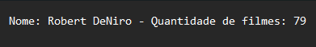  

📌 **Etapa 2 - Média da receita de bilheteria bruta dos principais filmes**  
👉 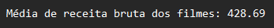

📌 **E03 - Ator/Atriz com a maior média de receita de bilheteria bruta**  
👉 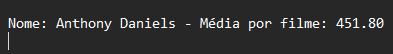

📌 **E04 - Contagem de aparições dos filmes mais recorrentes no dataset**  
👉 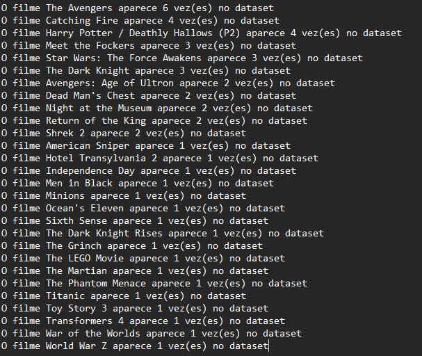

📌 **E05 - Lista dos atores ordenada pela receita bruta total dos filmes**  
👉 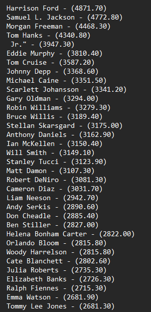

---

# Conclusão  

Nesta Sprint, consegui consolidar o conhecimento em manipulação de arquivos, uso de funções de alta ordem e otimização de código Python. Os exercícios reforçaram a importância de técnicas eficientes para processar grandes volumes de dados e estruturá-los de maneira compreensível e funcional.  

Com a realização exercício de **ETL**, foi possível aplicar esses conhecimentos em um contexto real, fortalecendo a compreensão sobre extração, transformação e carga de dados utilizando apenas recursos básicos da linguagem Python. Além disso, o desafio principal da Sprint, que envolveu a análise exploratória e visualização de dados utilizando as bibliotecas Pandas e Matplotlib, contribuiu significativamente para o aprimoramento da minha capacidade analítica e visual de dados complexos.  

Com esse aprendizado, sinto-me mais preparado para lidar com desafios que envolvem processamento de dados, organização de informações, manipulação eficiente de arquivos e criação de visualizações informativas em Python. 

