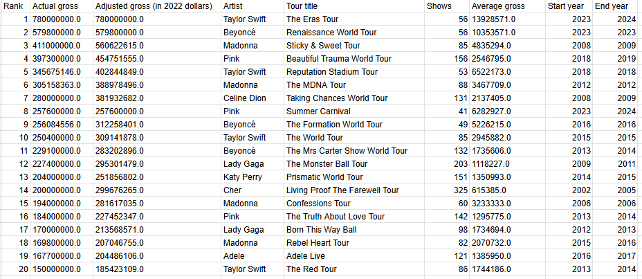
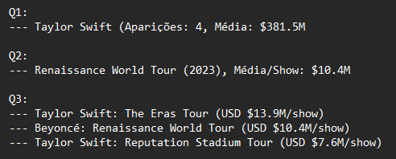
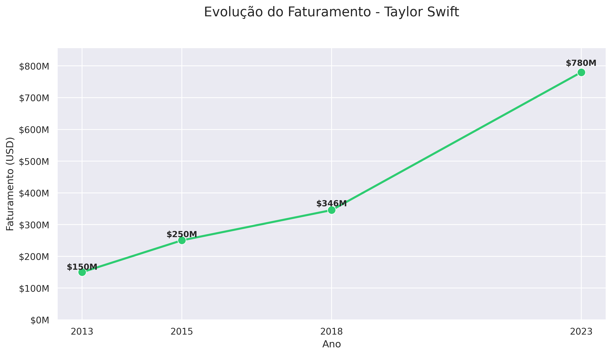
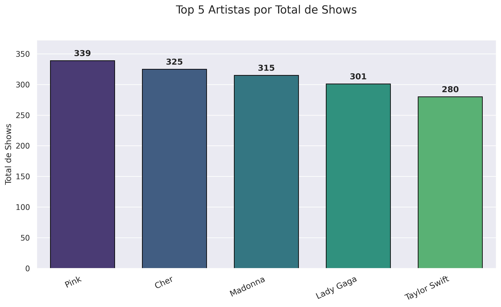
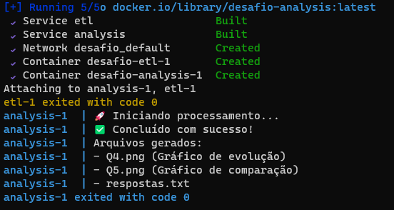
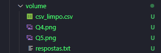

# 🎤 Desafio Sprint 3

## 📌 Introdução

Este projeto apresenta minha solução completa e detalhada para o **desafio da Sprint 3**, utilizando Python, Pandas, Matplotlib, Seaborn e Docker. O processo incluiu:
- Limpeza e preparação dos dados (ETL);
- Análise exploratória com respostas explicadas;
- Visualizações gráficas;
- Containerização com Docker.

---

## 📚 Bibliotecas Utilizadas

| Biblioteca   | Versão   | Finalidade |
|--------------|----------|------------|
| `pandas`     | 1.5.3    | Manipulação de dados, limpeza e análise tabular |
| `numpy`      | 1.23.5   | Suporte a operações numéricas com arrays |
| `matplotlib` | 3.7.1    | Criação de gráficos e visualizações básicas |
| `seaborn`    | 0.12.2   | Visualizações estatísticas com estilo aprimorado |
| `re`         | embutido | Expressões regulares para limpeza e padronização textual |

Instaladas via `pip` dentro de cada container no Dockerfile.

---

## 📂 Estrutura do Projeto

```
Desafio/
├── analysis/
│   ├── job.py
│   └── Dockerfile
├── etl/
│   ├── dados.csv
│   ├── etl.py
│   └── Dockerfile
├── volume/
│   ├── csv_limpo.csv
│   ├── respostas.txt
│   ├── Q4.png
│   └── Q5.png
└── docker-compose.yml
```

---


## ✅ Etapa 1 – ETL: Limpeza e Transformação dos Dados

🔗 **Código completo disponível em:** [etl.py](../Desafio/etl/etl.py)

### 🎯 O que foi feito:
- Leitura do CSV original `concert_tours_by_women.csv` com Pandas;
- Renomeação de colunas para facilitar o uso;
- Conversão de valores monetários e quantitativos para float/int;
- Separação da coluna `Year(s)` em `Start year` e `End year`;
- Padronização dos nomes das turnês com expressões regulares;

### 💡 Por que foi feito:
Essas transformações foram necessárias para padronizar os dados, permitir análises temporais e garantir integridade nas operações matemáticas e agrupamentos.

### 🧠 Como foi feito – Trechos de código:

**Leitura e renomeação:**
```python
import pandas as pd
import re

df = pd.read_csv('dados.csv', encoding='utf-8')
df.rename(columns={
    'Adjustedgross (in 2022 dollars)': 'Adjusted gross (in 2022 dollars)',
    'Year(s)': 'Years'
}, inplace=True)
```

**Limpeza numérica com regex:**
```python
numeric_columns = ['Actual gross', 'Adjusted gross (in 2022 dollars)', 'Average gross']
for col in numeric_columns:
    df[col] = df[col].astype(str).str.replace(r'[^\d.]', '', regex=True).astype(float)
```

**Conversão e separação dos anos:**
```python
df[['Start year', 'End year']] = df['Years'].str.split('-', expand=True)
df['End year'] = df['End year'].fillna(df['Start year']).astype(int)
df['Start year'] = df['Start year'].astype(int)
```

**Função de limpeza textual:**
```python
def clean_tour_title(title):
    title = re.sub(r'(?<=[a-zÀ-ÿ])(?=[A-ZÀ-Ÿ])|(?<=[A-ZÀ-Ÿ]{2})(?=[A-ZÀ-Ÿ][a-zÀ-ÿ])', ' ', title)
    title = re.sub(r'[^a-zA-ZÀ-ÿ&]\s*$', '', title)
    title = re.sub(r'[^a-zA-ZÀ-ÿ&()\- ]', ' ', title)
    title = re.sub(r'\s+', ' ', title).strip()
    title = re.sub(r'\s[a-zA-ZÀ-ÿ]\s*$', '', title)
    return title

df['Tour title'] = df['Tour title'].apply(clean_tour_title)
df['Artist'] = df['Artist'].str.replace(r'[^a-zA-ZÀ-ÿ ]', '', regex=True)
```

**Exportação do CSV final:**
```python
df.to_csv('/app/data/csv_limpo.csv', index=False, float_format='%.1f', encoding='utf-8-sig')
```

**📸 Evidência:** 


---

## ✅ Etapa 2 – Análise e Respostas 

🔗 **Código completo disponível em:** [job.py](../Desafio/analysis/job.py)

### 🎯 O que foi feito:
- Respondi às três perguntas principais com base no DataFrame limpo;
- Criei métricas auxiliares como `Per Show Adjusted` para calcular o rendimento por show.

### 💡 Por que foi feito:
A análise visa responder perguntas sobre artistas, faturamento e turnês de maneira confiável com base em dados estruturados.

### 🧠 Como foi feito – Trechos de código:

**Cálculo de métrica personalizada:**
```python
df["Per Show Adjusted"] = df["Adjusted gross (in 2022 dollars)"] / df["Shows"]
```

###  Q1 – Enunciado:

> **Qual é a artista que mais aparece nessa lista e possui a maior média de seu faturamento bruto (Actual gross)?**

#### 💡 Como resolvi:

Utilizei o `groupby` para agrupar os dados por artista, contei quantas vezes cada artista apareceu na lista e calculei a média de faturamento bruto (`Actual gross`). Em seguida, ordenei pela quantidade de aparições e, em caso de empate, pela média de faturamento.

```python
artist_stats = df.groupby("Artist").agg(
    Appearances=("Rank", "count"),
    Avg_Actual_Gross=("Actual gross", "mean")
).reset_index()

q1 = artist_stats.sort_values(
    ["Appearances", "Avg_Actual_Gross"], ascending=[False, False]
).iloc[0]
```

---

###  Q2 – Enunciado:

> **Das turnês que aconteceram em um ano, apresente a turnê com a maior média de faturamento bruto (Average gross).**

#### 💡 Como resolvi:

Filtrei as turnês cujo `Start year` é igual ao `End year`, indicando que ocorreram em apenas um ano. Depois, selecionei a que possui o maior valor em `Average gross`.

```python
single_year = df[df["Start year"] == df["End year"]]
q2 = single_year.loc[single_year["Average gross"].idxmax()]
```

---

###  Q3 – Enunciado:

> **Quais são as 3 artistas que possuem o show (unitário) mais lucrativo, dentro de uma turnê? Cite também o nome dessas turnês para cada artista. Utilize a coluna “Adjusted gross (in 2022 dollars)”. Caso necessário, crie uma coluna nova para essa conta.**

#### 💡 Como resolvi:

Criei uma nova coluna `Per Show Adjusted`, que divide o faturamento ajustado pelo número de shows. Em seguida, ordenei o DataFrame por essa coluna em ordem decrescente e selecionei os três primeiros resultados.

```python
df["Per Show Adjusted"] = df["Adjusted gross (in 2022 dollars)"] / df["Shows"]
q3 = df.sort_values("Per Show Adjusted", ascending=False).head(3)
```

**📸 Evidência com as respostas:**   



---

## ✅ Etapa 3 – Visualizações Gráficas (Q4–Q5)

🔗 **Código completo disponível em:** [job.py](../Desafio/analysis/job.py)

### 🎯 O que foi feito:
- Criação de dois gráficos profissionais:
  - Evolução do faturamento do artista com mais turnês;
  - Comparativo dos artistas com mais shows.

### 💡 Por que foi feito:
Os gráficos ajudam a comunicar insights visuais com clareza e impacto.

### 🧠 Como foi feito – Exemplo Q4 e Q5:

###  Q4: Evolução do faturamento (gráfico de linha):
#### 💡 Como resolvi:
Filtrei os dados apenas para a artista que mais aparece na lista e agrupei por `Start year`. Em seguida, criei um gráfico de linha utilizando o Seaborn, relacionando os anos com os valores de faturamento (`Actual gross`).
```python
artist_data = df[df["Artist"] == q1["Artist"]]
sns.lineplot(x="Start year", y="Actual gross", data=artist_data, marker="o")
plt.title("Evolução do Faturamento")
plt.savefig("/app/data/Q4.png")
```
**📸 Evidência:** 


### Q5 – Top 5 artistas com mais shows (gráfico de barras):
#### 💡 Como resolvi:
Agrupei os dados por artista, somei o total de shows de cada uma, selecionei as cinco com maiores valores e gerei um gráfico de barras utilizando o Seaborn.

```python
top_artists = df.groupby("Artist")["Shows"].sum().nlargest(5).reset_index()
sns.barplot(x="Artist", y="Shows", data=top_artists)
plt.title("Top 5 Artistas por Total de Shows")
plt.ylabel("Total de Shows")
plt.xticks(rotation=25)
plt.savefig("/app/data/Q5.png")
```
```python
artist_data = df[df["Artist"] == q1["Artist"]]
sns.lineplot(x="Start year", y="Actual gross", data=artist_data, marker="o")
plt.title("Evolução do Faturamento")
plt.savefig("/app/data/Q4.png")
```
**📸 Evidência:** 




## ✅ Etapa 4 – Dockerização e Automação

Essa etapa atende aos requisitos da Etapa 5 do enunciado, que exige:
- Dois `Dockerfile` separando as etapas de ETL e Análise;
- Um arquivo `docker-compose.yml` conectando os dois containers;
- Um volume compartilhado (`./volume`) que permita a troca de arquivos entre eles;
- Execução final feita exclusivamente via `docker-compose`.

O diretório `./volume` foi usado como volume mapeado, conforme solicitado, e armazena os arquivos:
- `csv_limpo.csv`: gerado na etapa de ETL;
- `respostas.txt`, `Q4.png`, `Q5.png`: gerados na etapa de análise.

Esse volume é acessado dentro dos containers através do caminho `/app/data`, como configurado abaixo:

🔗 **Dockerfiles disponíveis em:** [Dockerfile etl](../Desafio/etl/Dockerfile) e [Dockerfile job](../Desafio/analysis/Dockerfile)
🔗 **Orquestração disponível em:** [docker-compose](../Desafio/docker-compose.yml)

### 🎯 O que foi feito:
- Criei dois Dockerfiles: um para o ETL e outro para a análise;
- Configurei o [docker-compose](../Desafio/docker-compose.yml) para orquestrar a execução.

### 💡 Por que foi feito:
Automatizar o processo garante reprodutibilidade, isolamento de ambiente e facilita o uso do projeto.

### 🧠 Como foi feito – Detalhamento da Execução:

**Dockerfile ETL:**
```Dockerfile
FROM python:3.9-slim
WORKDIR /app
RUN pip install numpy==1.23.5 pandas==1.5.3
COPY dados.csv /app/dados.csv
COPY etl.py /app/etl.py
CMD ["python", "etl.py"]
```

**Dockerfile Analysis:**
```Dockerfile
FROM python:3.9-slim
WORKDIR /app
RUN pip install numpy==1.23.5 pandas==1.5.3 matplotlib==3.7.1 seaborn==0.12.2
COPY job.py /app/job.py
CMD ["python", "job.py"]
```

**docker-compose.yml:**
```yaml
services:
  etl:
    build: ./etl
    volumes:
      - ./volume:/app/data

  analysis:
    build: ./analysis
    volumes:
      - ./volume:/app/data
    depends_on:
      - etl
```

**Execução final com Docker Compose:**

A execução do projeto é feita de forma totalmente automatizada utilizando o Docker Compose. Abaixo está o passo a passo detalhado:

1. **Criação dos containers**  
   Ao executar o Docker Compose com o comando abaixo, o sistema irá construir automaticamente as imagens Docker para os serviços `etl` e `analysis` a partir dos seus respectivos `Dockerfile`:
   
   ```bash
   docker-compose up --build
   ```

2. **Execução do ETL**  
   O primeiro container a ser iniciado é o `etl`. Ele executa o script `etl.py`, que realiza toda a limpeza e transformação dos dados e salva o resultado em `/app/data/csv_limpo.csv`, dentro do volume compartilhado (`./volume`).

3. **Execução da Análise**  
   Após a conclusão do container `etl`, o container `analysis` é iniciado automaticamente (graças ao parâmetro `depends_on`). Ele executa o `job.py`, que lê o arquivo limpo e gera as respostas (`respostas.txt`) e gráficos (`Q4.png` e `Q5.png`).

4. **Arquivos finais**  
   Todos os arquivos gerados pelos containers são armazenados no diretório local `./volume`, permitindo fácil acesso aos resultados após a execução.

Esse fluxo completo — da limpeza à análise — é disparado com apenas **um único comando**.

```bash
docker-compose up --build
```

Esse comando:
1. Constrói a imagem do serviço `etl` e executa o script `etl.py`, que gera o `csv_limpo.csv` e o salva em `/app/data` (mapeado como `./volume`).
2. Após finalizar o ETL, o serviço `analysis` é iniciado automaticamente (graças ao `depends_on`), executando o `job.py`, que gera o `respostas.txt` e os gráficos `Q4.png` e `Q5.png` na mesma pasta compartilhada.

Todo o fluxo é automatizado: basta um único comando para realizar a cadeia completa de ETL, análise e visualização, com os arquivos finais salvos em `./volume`.


**📸 Evidência:** 





**Arquivos gerados:**

[CSV LIMPO](./volume/csv_limpo.csv)

[Q4](./volume/Q4.png)

[Q5](./volume/Q5.png)

[RESPOSTAS](./volume/respostas.txt)

---

## ✅ Requisitos Atendidos

- [x] ETL estruturado e automatizado com limpeza inteligente (regex);
- [x] Análise com métricas relevantes e cálculos corretos;
- [x] Visualizações gráficas com qualidade estética e legibilidade;
- [x] Processo automatizado com Docker e Docker Compose;

---


