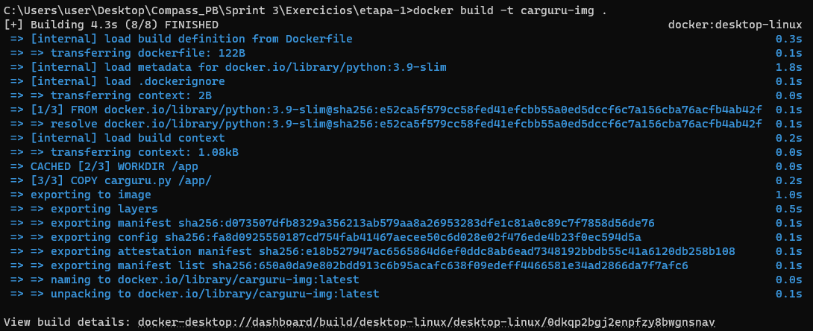
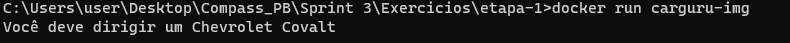
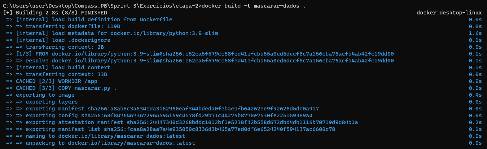
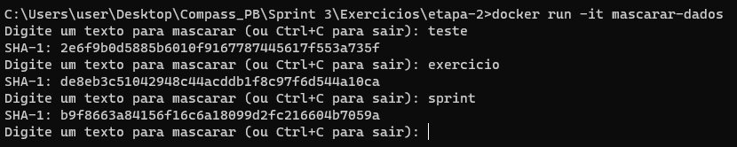
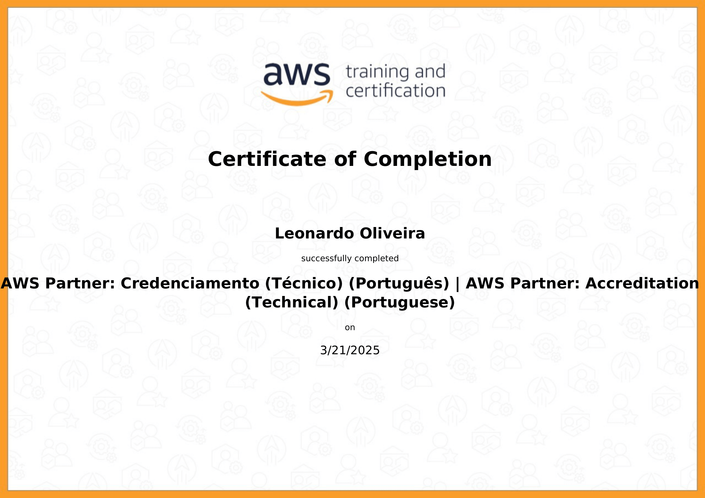

# Resumo

**ETL com Python e Pandas:** Aprofundei o uso de Pandas para transformar dados reais, padronizar colunas, limpar registros inconsistentes e salvar arquivos finais.

**Visualização com Matplotlib e Seaborn:** Desenvolvi gráficos personalizados para comunicar insights de forma clara e visualmente agradável.

**Docker:** Aprendi a empacotar scripts Python em containers Docker, automatizar execuções com `docker-compose` e utilizar volumes para compartilhamento de dados.

---

## 1. Desafio da Sprint – Concert Tours

O desafio consistiu em aplicar todo o fluxo de ETL + Análise + Visualização, utilizando Python, Pandas, Matplotlib, Seaborn e Docker. 

O projeto foi dividido em 4 etapas principais:
- Limpeza e transformação dos dados (ETL);
- Análise e geração de respostas (Q1, Q2, Q3);
- Visualizações gráficas (Q4, Q5);
- Automatização via Docker Compose.

[README completo do Desafio](Desafio/README.md)

## 2. Exercício – Containers com Docker

Este exercício prático teve como objetivo reforçar os conhecimentos de Docker adquiridos durante a sprint, através da criação e execução de dois containers com funcionalidades distintas. A seguir, detalho cada etapa com clareza.

### 🧩 Etapa 1 – Execução automatizada com `carguru.py`

**Objetivo:** Criar uma imagem Docker capaz de rodar automaticamente um script Python que imprime uma marca de carro aleatória.

**Etapas realizadas:**

1. Construí um `Dockerfile` com a imagem base `python:3.9-slim`, defino o diretório de trabalho e copio o script para dentro do container. O comando `CMD` garante que o script será executado automaticamente ao iniciar o container.

```dockerfile
FROM python:3.9-slim
WORKDIR /app
COPY carguru.py .
CMD ["python", "carguru.py"]
```

3. Para construir a imagem e executar o container utilizei os seguintes comandos:

```bash
docker build -t carguru-img .
docker run carguru-img
```

4. Após execução, o container imprime a marca do carro e finaliza. É possível reutilizar a instância com `docker start` e visualizar a saída com `docker logs`.

---

### 🧩 Etapa 2 – Execução interativa com `mascarar.py`

**Objetivo:** Criar um container interativo onde o usuário insere um texto e recebe o hash SHA-1 correspondente em tempo real.

**Etapas realizadas:**

1. Desenvolvi o script `mascarar.py` que entra em um loop infinito utilizando `input()` para ler entradas do usuário e a biblioteca `hashlib` para gerar o hash no formato SHA-1.

```python
import hashlib

while True:
    texto = input("Digite um texto para mascarar (ou Ctrl+C para sair): ")
    hash_resultado = hashlib.sha1(texto.encode()).hexdigest()
    print(f"SHA-1: {hash_resultado}
")
```

2. Criei um novo `Dockerfile` com base no mesmo modelo, apenas alterando o script copiado e executado:

```dockerfile
FROM python:3.9-slim
WORKDIR /app
COPY mascarar.py .
CMD ["python", "mascarar.py"]
```

3. A imagem foi construída e o container executado no modo interativo com:

```bash
docker build -t mascarar-dados .
docker run -it mascarar-dados
```

4. O parâmetro `-it` é essencial aqui pois permite a interação com o terminal. A cada entrada, o usuário recebe o hash correspondente. O processo só é encerrado com `Ctrl+C`.

**Importância do exercício:**
- Consolidou o entendimento de como empacotar scripts Python simples em containers reutilizáveis.
- Demonstrou como lidar com containers interativos usando `-it`.
- Reforçou a construção de `Dockerfile` funcionais e minimalistas.

---


## Exercício – Evidências

#### Build `carguru`


#### Execução do container `carguru`


#### Build `mascarar`


#### Execução do container interativo `mascarar`


---

# Certificados

**AWS Accreditation Techinical**



---


