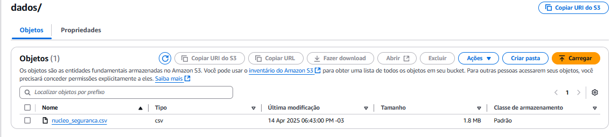
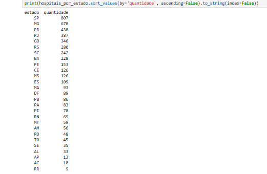
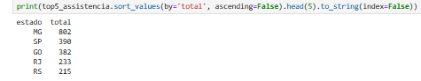
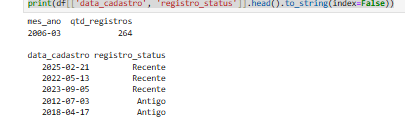
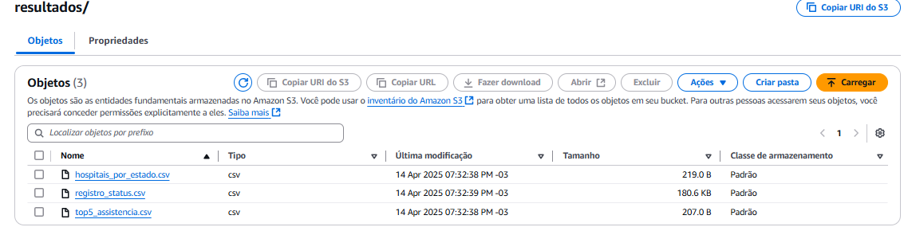

# Desafio AWS — Núcleo de Segurança do Paciente (NSP)

## 🎯 Objetivo
Este desafio tem como propósito exercitar a integração entre **serviços de nuvem (AWS S3)** e **manipulação de dados com Python**, utilizando `boto3` e `pandas`. O desafio foi realizado e dividido em duas etapas:

- **Etapa 1:** Envio de um arquivo `.csv` para um bucket criado na AWS
- **Etapa 2:** Leitura do arquivo a partir do S3, realização de 3 análises com diferentes manipulações e reenvio dos resultados ao bucket

---

## 📄 Descrição do Desafio

**Requisitos técnicos obrigatórios:**

- Criar bucket novo no S3
- Enviar arquivo CSV via boto3
- A partir do arquivo hospedado, aplicar:
  - 1 cláusula com dois operadores lógicos
  - 1 função de agregação
  - 1 função condicional
  - 1 função de conversão
  - 1 função de data
  - 1 função de string
- Salvar os resultados em `.csv` e enviar para o bucket

---

### 📦 Bibliotecas Utilizadas

Durante o desafio, foram utilizadas as seguintes bibliotecas Python:

- **`boto3`**: principal biblioteca para interação com os serviços da AWS. Foi usada para:
  - Criar o bucket no S3
  - Fazer upload do arquivo original
  - Ler o arquivo diretamente do S3
  - Enviar os arquivos resultantes das análises de volta para o bucket

- **`pandas`**: utilizada para manipulação e análise de dados, com recursos como:
  - Filtros condicionais
  - Funções de string, data e agregação
  - Exportação de arquivos `.csv`

- **`io.StringIO`**: usada para manipular arquivos `.csv` em memória antes de enviá-los ao S3 com `put_object`.

---

## 📂 Dataset: Núcleo de Segurança do Paciente (NSP)

**Fonte:** dados públicos do governo  
**Arquivo original:** `nucleo_seguranca.csv`  
**Bucket criado:** `pb-desafio-leonardo`

### 📌 Colunas originais:

- `#UF`
- `MUNICIPIO`
- `NOME_FANTASIA`
- `NOME_RAZAO_SOCIAL`
- `NU_CNPJ`
- `CNES`
- `DT_CADASTRO_PJ`
- `CATEGORIA`
- `SUB_CATEGORIA`
- `NU_CNPJ_MANTENEDORA`
- `TP_CLASSIFICACAO`

---

## 🔧 Transformações Realizadas

As colunas foram renomeadas para facilitar a manipulação, seguindo o padrão `snake_case`. As colunas de CNPJ foram descartadas por não serem úteis nas análises.

### 📑 Dicionário de Dados Final (após tratamento):

| Coluna             | Descrição                                          |
|--------------------|----------------------------------------------------|
| `estado`           | Unidade federativa (UF)                            |
| `cidade`           | Município                                          |
| `nome_fantasia`    | Nome público da instituição                        |
| `razao_social`     | Razão social (nome jurídico)                       |
| `codigo_cnes`      | Código nacional do estabelecimento de saúde        |
| `data_cadastro`    | Data de cadastro no sistema                        |
| `categoria`        | Tipo de instituição (ex: Hospital, Assistência)    |
| `subcategoria`     | Subclassificação institucional                     |
| `tipo_classificacao` | Classificação oficial do tipo de instituição     |

---

## 🚀 Etapa 1 — Criação do Bucket e Envio do Arquivo

Utilizei `boto3` com **credenciais manuais** no script, por ser a forma mais didática e recomendada pelo enunciado. Embora existam métodos mais seguros (`aws configure`, variáveis de ambiente), optei por seguir o modelo proposto.

### 📜 Código de criação e upload:

```python
s3 = boto3.client('s3',
    aws_access_key_id=aws_access_key_id,
    aws_secret_access_key=aws_secret_access_key,
    aws_session_token=aws_session_token
)

# Criar bucket
s3.create_bucket(Bucket='pb-desafio-leonardo')

# Enviar arquivo CSV
s3.upload_file('nucleo_seguranca.csv', 'pb-desafio-leonardo', 'nucleo_seguranca.csv')
```

📸  
📸
📸

---

## 🔽 Etapa 2 — Leitura do Arquivo do S3 e Análises

### 📥 Leitura do arquivo com Pandas via S3e tratamento dos dados:

```python
import pandas as pd
from datetime import datetime

# Carregamento dos dados
df = pd.read_csv('nucleo_seguranca.csv', sep=';', encoding='latin1')

# Renomeação de colunas
df.rename(columns={
    '#UF': 'estado',
    'MUNICIPIO': 'cidade',
    'NOME_FANTASIA': 'nome_fantasia',
    'NOME_RAZAO_SOCIAL': 'razao_social',
    'NU_CNPJ': 'cnpj',
    'CNES': 'codigo_cnes',
    'DT_CADASTRO_PJ': 'data_cadastro',
    'CATEGORIA': 'categoria',
    'SUB_CATEGORIA': 'subcategoria',
    'NU_CNPJ_MANTENEDORA': 'cnpj_mantenedora',
    'TP_CLASSIFICACAO': 'tipo_classificacao'
}, inplace=True)

# Limpeza inicial
df['data_cadastro'] = pd.to_datetime(df['data_cadastro'], errors='coerce')
df.drop_duplicates(inplace=True)
df.drop(['cnpj', 'cnpj_mantenedora'], axis=1, inplace=True)
df['categoria'] = df['categoria'].str.strip().str.upper()
df['tipo_classificacao'] = df['tipo_classificacao'].str.strip().str.upper()
df['subcategoria'] = df['subcategoria'].str.strip().str.upper()
```

---

## 📊 Análises Realizadas

Foram realizadas 3 análises distintas, cada uma com pelo menos uma manipulação obrigatória. Os resultados foram salvos em `.csv` e enviados ao bucket.

---

### 🔹 Análise 1 — Hospitais por Estado

**Objetivo:** Verificar a quantidade de hospitais que possuem atuação relacionada à segurança do paciente.

**Justificativa:** Instituições hospitalares com esse foco são estratégicas para políticas públicas de saúde.

**Manipulações aplicadas:**
- ✔️ Filtro com dois operadores lógicos
- ✔️ Função de string
- ✔️ Agregação por estado

```python
df_hospitais = df[
    (df['categoria'] == 'HOSPITAL') &
    (df['tipo_classificacao'] == 'HOSPITAL') &
    (df['subcategoria'].str.contains('SEGURANÇA', na=False))
]
hospitais_por_estado = df_hospitais.groupby('estado').size().reset_index(name='quantidade')
```

📁 Arquivo gerado: [hospitais_por_estado.csv](../Desafio/Resultados/hospitais_por_estado.csv)  
📸 📸

---

### 🔹 Análise 2 — Estabelecimentos de Assistência por Estado

**Objetivo:** Identificar os estados com maior número de estabelecimentos assistenciais à saúde.

**Justificativa:** São instituições que atendem demandas contínuas da população.

**Manipulações aplicadas:**
- ✔️ Função de string (busca por "ASSISTÊNCIA")
- ✔️ Conversão: extração do ano
- ✔️ Agregação por estado

```python
df_assistencia = df[df['categoria'].str.contains('ASSISTÊNCIA', case=False, na=False)].copy()
df_assistencia['ano_cadastro'] = df_assistencia['data_cadastro'].dt.year
top5_assistencia = df_assistencia.groupby('estado').size().reset_index(name='total')
```

📁 Arquivo gerado: [top5_assistencia.csv](../Desafio/Resultados/top5_assistencia.csv)  
📸 

---

### 🔹 Análise 3 — Classificação por Período (Recente ou Antigo)

**Objetivo:** Classificar registros por faixa temporal e descobrir o mês com maior número de cadastros.

**Decisão técnica:** O resultado salvo no CSV contém apenas a classificação `registro_status`, pois a agregação mensal foi usada apenas como apoio no notebook.

**Manipulações aplicadas:**
- ✔️ Função de data (mês/ano)
- ✔️ Função condicional com `apply`
- ✔️ Agregação mensal (uso interno)

```python
df['mes_ano'] = df['data_cadastro'].dt.to_period('M')
cadastros_mes = df.groupby('mes_ano').size().reset_index(name='qtd_registros')
df['registro_status'] = df['data_cadastro'].apply(lambda x: 'Recente' if x >= pd.Timestamp('2020-01-01') else 'Antigo')
```

📁 Arquivo gerado: [registro_status.csv](../Desafio/Resultados/registro_status.csv)   
📸

---

## 📤 Envio dos Arquivos Resultantes para o Bucket

Os arquivos gerados foram enviados para o bucket `pb-desafio-leonardo` na pasta `resultados/`.

```python
def enviar_para_s3(df_resultado, nome_saida):
    buffer = StringIO()
    df_resultado.to_csv(buffer, index=False)
    s3.put_object(
        Bucket='pb-desafio-leonardo',
        Key=f'resultados/{nome_saida}',
        Body=buffer.getvalue()
    )
```

📁 Enviados:
- [hospitais_por_estado.csv](../Desafio/Resultados/hospitais_por_estado.csv)  
- [top5_assistencia.csv](../Desafio/Resultados/top5_assistencia.csv) 
- [registro_status.csv](../Desafio/Resultados/registro_status.csv) 


📸

📸

---

## 🔗 Arquivos e Organização

- [Script 1](../Desafio/etapa1.ipynb) 
- [Script 2](../Desafio/etapa2.ipynb) 
- [arquivos `.csv` gerados ](../Desafio/Resultados/)   
- [Evidencias](../Desafio/Evidencias/) 


---

## 🧾 Scripts Desenvolvidos

Durante o desenvolvimento do desafio, foram utilizados **três notebooks/scripts** principais, cada um com uma função específica:

---

### 🟢 Etapa 1 — Criação do Bucket e Upload do Arquivo

**Notebook:** [Script 1](../Desafio/etapa1.ipynb) 

Este script tem como objetivo:
- Criar o bucket `pb-desafio-leonardo` na AWS S3
- Enviar o arquivo `nucleo_seguranca.csv` **sem nenhuma modificação**
- Utiliza `boto3` com credenciais manuais (temporárias)

**Resumo do fluxo:**
```python
s3 = boto3.client('s3', aws_access_key_id=..., aws_secret_access_key=..., aws_session_token=...)
s3.create_bucket(Bucket='pb-desafio-leonardo')
s3.upload_file('nucleo_seguranca.csv', 'pb-desafio-leonardo', 'dados/nucleo_seguranca.csv')
```

🔐 *As credenciais foram utilizadas diretamente no script apenas para fins didáticos, conforme o enunciado. Não foram expostas neste README.*


---


### 📗 Etapa 2 — Tratamento e análise dos dados
**Notebook:** [Script 2](../Desafio/etapa2.ipynb) 

Este notebook foi utilizado para:
- **Ler diretamente o arquivo do S3** (sem salvar localmente)
- Aplicar as mesmas limpezas e análises validadas no notebook local
- Gerar os arquivos `.csv` com os resultados
- Enviar os arquivos automaticamente de volta para a pasta `/resultados/` no bucket

**Resumo do fluxo:**
```python
# Leitura
response = s3.get_object(Bucket='pb-desafio-leonardo', Key='dados/nucleo_seguranca.csv')
conteudo = response['Body'].read().decode('latin1')
df = pd.read_csv(StringIO(conteudo), sep=';')

# Upload dos resultados
def enviar_para_s3(df_resultado, nome_saida):
    buffer = StringIO()
    df_resultado.to_csv(buffer, index=False)
    s3.put_object(Bucket='pb-desafio-leonardo', Key=f'resultados/{nome_saida}', Body=buffer.getvalue())
```


---
