# Resumo

**AWS S3, Athena & Lambda:** Nesta sprint, aprofundei meus conhecimentos na criação de buckets S3 para hospedagem de site estático, consultas SQL com Athena (explorando arquivos CSV) e criação de funções serverless no AWS Lambda (com uso de layers para bibliotecas como Pandas).  

**Cloud Quest:** Participei do *AWS Cloud Quest*, um jogo interativo da AWS que permite aprender conceitos de nuvem de maneira gamificada, realizando desafios práticos. Isso reforçou minha base em IAM, EC2, S3 e arquitetura de soluções.  

**Desafio** Trabalhei com um dataset real, aplicando todos os conceitos de leitura/escrita em S3, manipulação de dados (filtros, agregações, etc.) e salvando resultados finais novamente no bucket. [Acesse o README completo do desafio aqui](Desafio/README.md).

---

## 1. Cloud Quest

Durante a sprint, participei do **AWS Cloud Quest**, uma experiência de aprendizado gamificada onde:

- **Construi soluções** em um ambiente virtual, recebendo *badges* e pontos à medida que completava missões (por exemplo, configurar instâncias, permissões, VPCs).  
- **Aprendi conceitos** de segurança, IAM, EC2, redes, escalabilidade e soluções serverless.  
- A experiência foi valiosa para reforçar conceitos de **melhores práticas** e **governança** na nuvem.

---

## 2. Exercícios Realizados

A seguir, descrevo cada exercício/laboratório e como eles se **encadeiam**, formando uma trilha de aprendizado que culmina no desafio final.

### 2.1. Laboratório S3
**Objetivo:** Familiarizar-se com o serviço de armazenamento de objetos da AWS, o Amazon S3, e criar uma base para os laboratórios seguintes.

- **Criação do Bucket:** Criei um bucket para hospedar arquivos e (opcionalmente) um site estático simples.  
- **Controle de Acesso:** Ajustei configurações de bloqueio de acesso público, defini política para permitir acesso anônimo aos arquivos HTML (caso de site) ou acesso restrito (no caso de CSVs).  
- **Upload de Arquivos:** Envie arquivos HTML e CSV para o bucket, que serão usados posteriormente no Athena e Lambda.

**Conexão:** Este bucket servirá como **fonte** de dados para o laboratório de Athena e para a função Lambda, garantindo que todos trabalhem sobre os mesmos arquivos no S3.

---

### 2.2. Laboratório Athena
**Objetivo:** Demonstrar como fazer consultas SQL diretamente em arquivos armazenados no S3, sem precisar configurar um banco de dados tradicional.

- **Banco de Dados e Tabela Externa:** Criei um *database* (lógico) no Athena e uma *tabela externa* apontando para o CSV que subi no laboratório de S3.  
- **Consultas e Agregações:** Usei `SELECT` para filtrar dados, agrupar por colunas (e.g. `GROUP BY`), ordenar (`ORDER BY`), e praticar *window functions* (como `ROW_NUMBER`).  
- **Teste de Queries:** Fiz consultas simples (listar top 15 nomes em determinado ano) e avançadas (ranking por década, etc.).

**Conexão:** O Athena **lê diretamente do bucket S3** criado no laboratório anterior, aproveitando o mesmo CSV. Em seguida, qualquer insight obtido via Athena pode inspirar transformações que faremos depois no Lambda ou localmente.

---

### 2.3. Laboratório Lambda + Layers
**Objetivo:** Criar uma função serverless que consome dados do S3, processa-os em Python (com pandas) e retorna um resultado, sem precisar gerenciar servidores.

- **Função Lambda:** Desenvolvi uma função em Python 3.9 que usa `boto3` para baixar o CSV do S3, carrega em `pandas` e conta o número de linhas.  
- **Layer para pandas/numpy:** Como pandas não vem por padrão na runtime, criei uma *layer* (camada) para empacotar as bibliotecas necessárias (pandas, numpy).  
- **Ajustes Finais:** Configurar timeouts, memória e roles de acesso adequadas para que a Lambda tenha permissão de ler o bucket.

**Conexão:** A Lambda pega **o mesmo arquivo** que o Athena analisou. Assim, fechamos o ciclo de “armazenar em S3” → “consultar com Athena” → “processar com Lambda”. A layer garante reuso de bibliotecas, caso surjam outras funções Lambda no futuro.

---

## 3. Evidências

Segue abaixo a evidência da realização dos exercícios propostos, em sequência:

1. 📸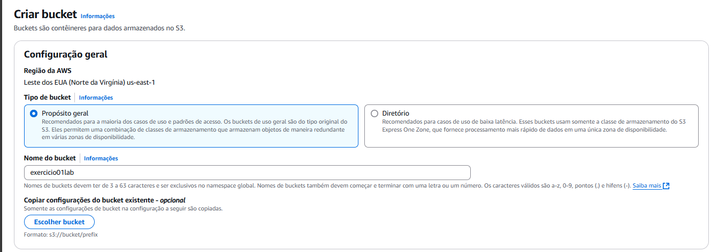
2. 📸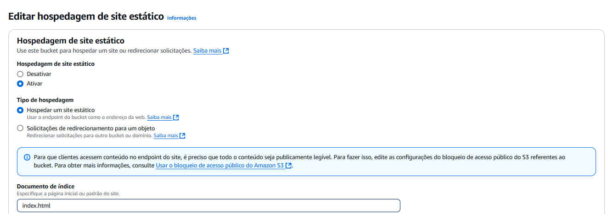
3. 📸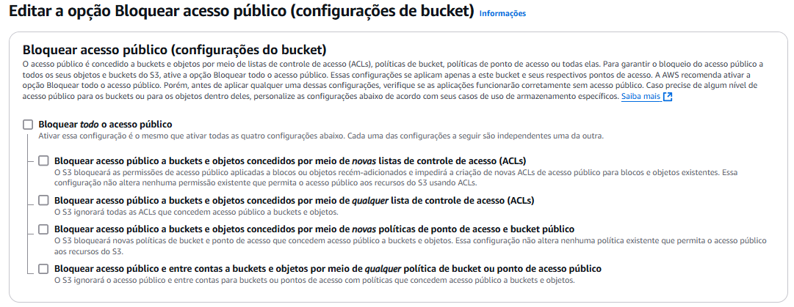
4. 📸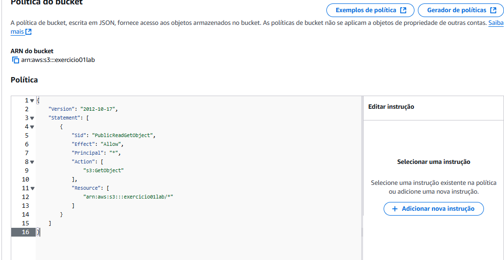
5. 📸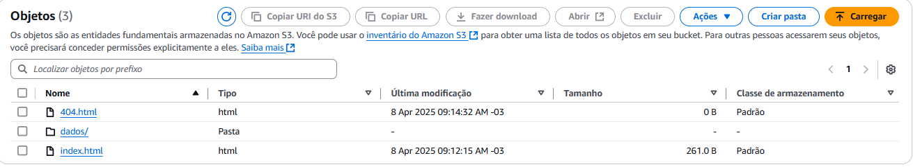
6. 📸
7. 📸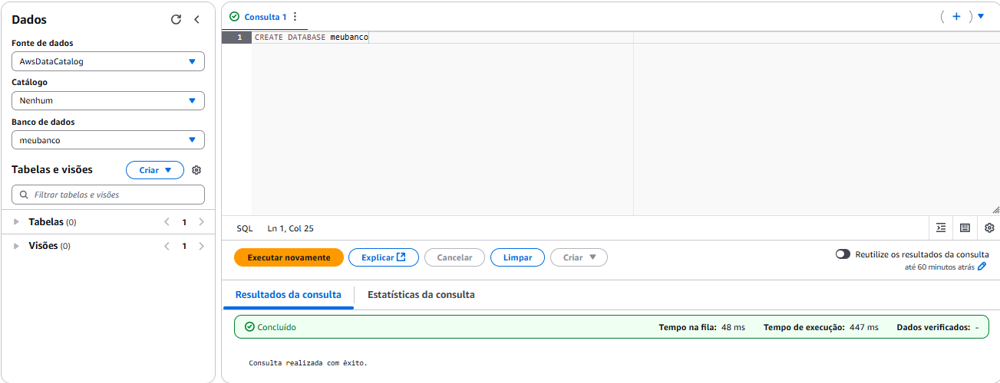
8. 📸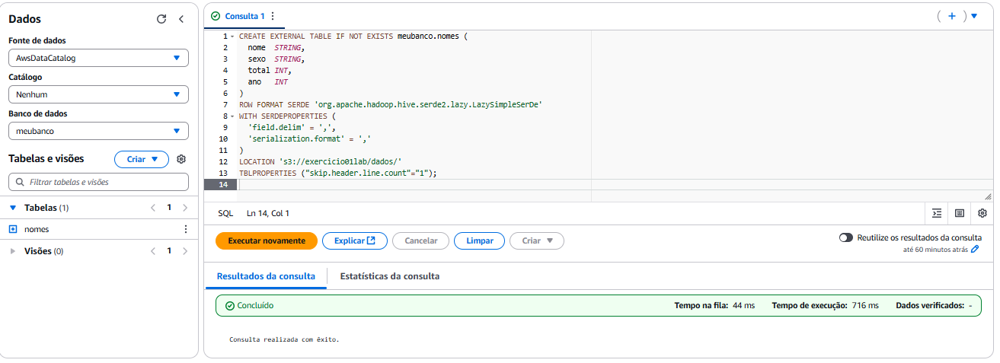
9. 📸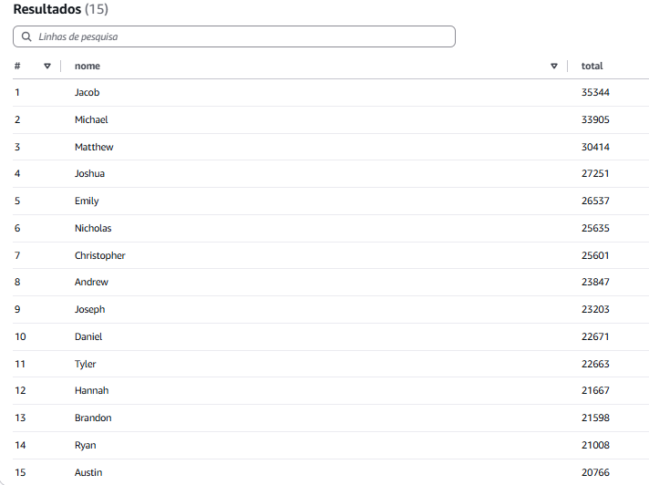
10. 📸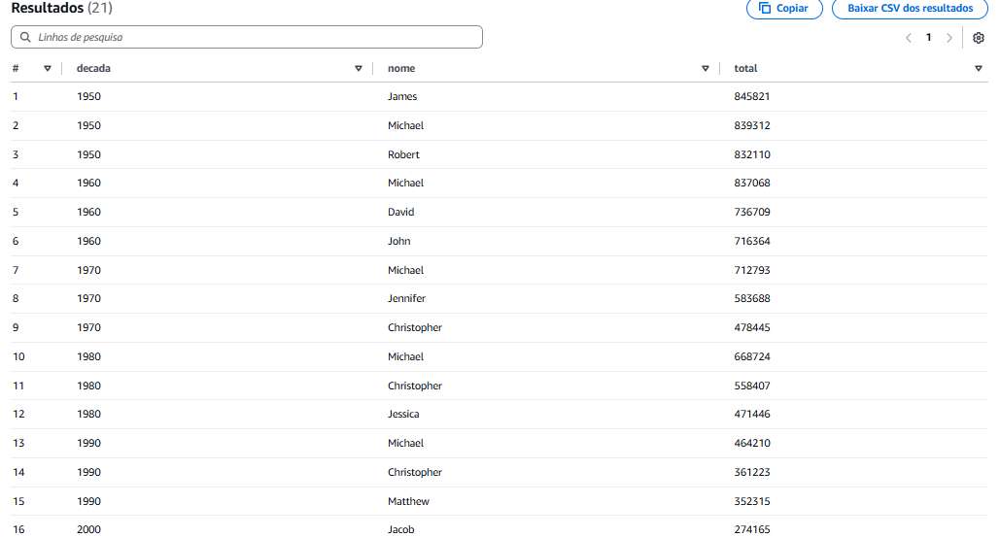
11. 📸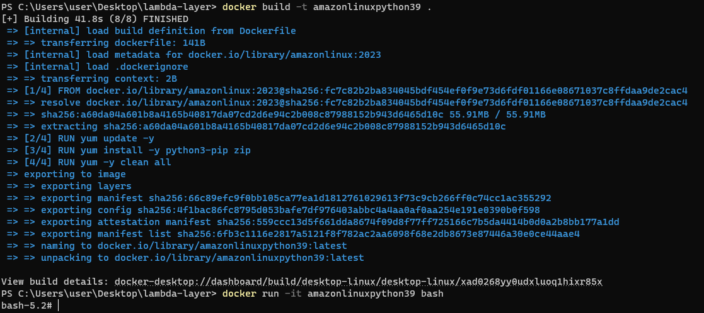
12. 📸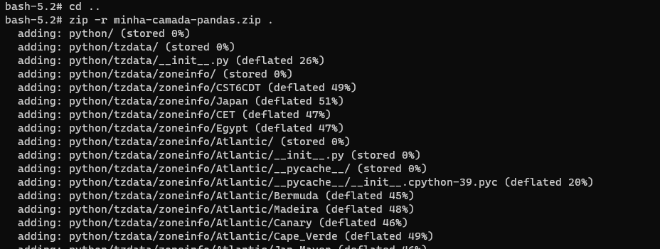
13. 📸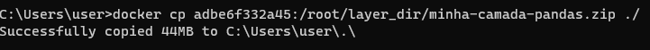
14. 📸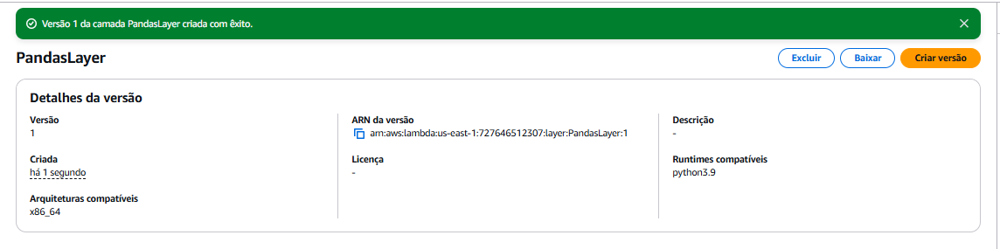
15. 📸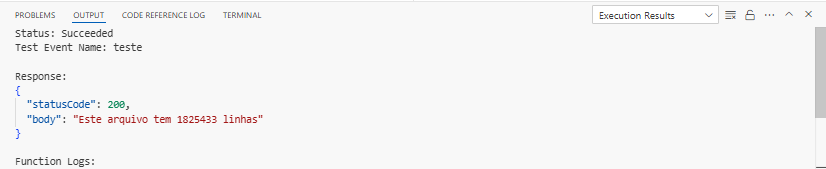

---

## 4. Certificados

Durante o período da sprint, também obtive/avancei em algumas certificações e/ou treinamentos:

1. **Cloud Quest:** 
 [Link Badge](Certificados/badge.txt)
2. **AWS Skill Builder - AWS Partner: Sales Accreditation (Business) (Portuguese)**  
   [Certificado](Certificados/AWS-Course-Completion-Certificate.pdf)
3. **AWS Partner: Economias na nuvem AWS**:
   [Certificado](Certificados/CloudEconomics.pdf)

---

# Conclusão

Esta sprint foi fundamental para consolidar conhecimentos em **serviços AWS** e **melhores práticas** de nuvem. Além dos laboratórios de **S3**, **Athena** e **Lambda**, realizei um **desafio** com um dataset real, aplicando transformações com **pandas**, e aprofundei o aprendizado com o **AWS Cloud Quest**. 
