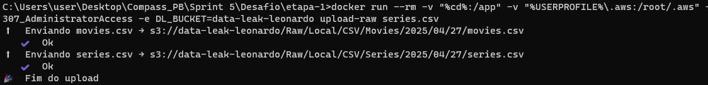
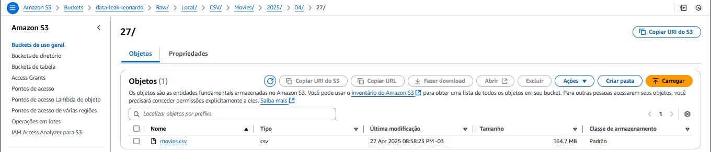
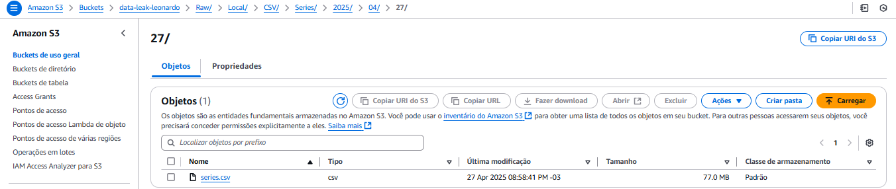
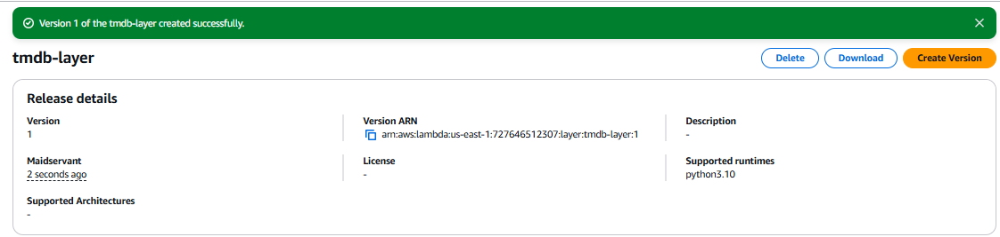
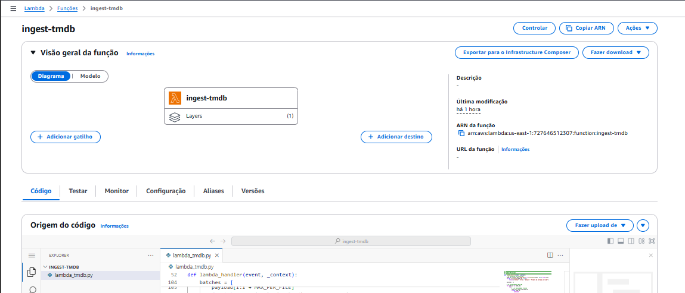
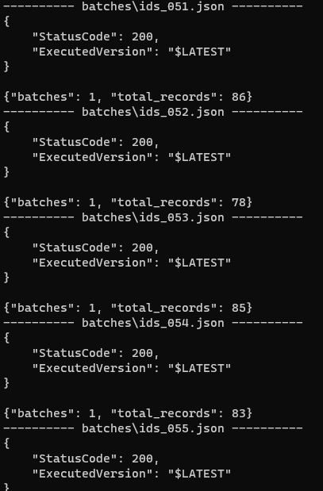
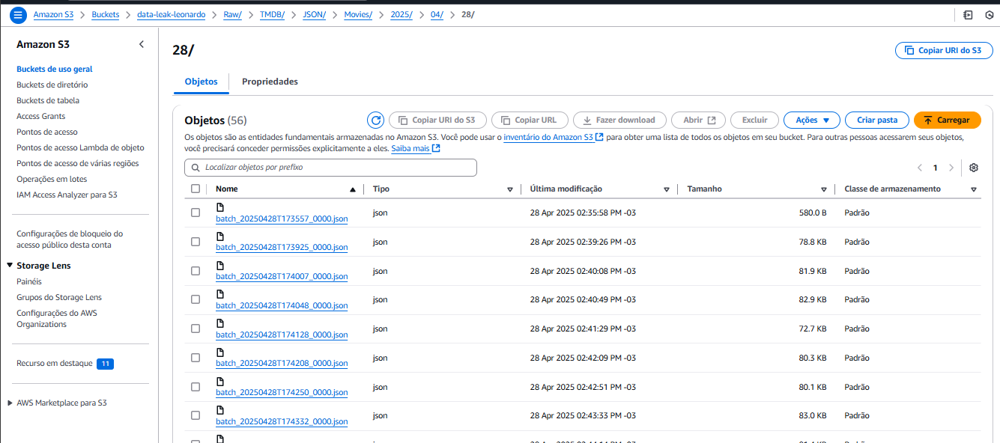

# 🎬 Desafio Data Lake Filmes & Séries

Este repositório reúne toda a solução desenvolvida para o **Desafio de Filmes e Séries**, cuja proposta é praticar a combinação de conceitos de Data Lake na AWS, englobando:

1. **Ingestão Batch** de arquivos CSV locais (Filmes e Séries) para a camada RAW do S3, usando Python, boto3 e Docker.  
2. **Ingestão de API** (TMDB) via AWS Lambda para complementar os dados CSV, gerando JSONs agrupados em lotes de até 100 registros.

---

## 🎯 Objetivos Gerais

- **Construir um Data Lake** simples para Filmes e Séries, com camadas RAW em S3.  
- **Etapa 1:** ingerir **na íntegra** dois CSVs (`Movies.csv`, `Series.csv`) para o S3, sem filtragens.  
- **Etapa 2:** complementar os dados CSV com informações do TMDB (via AWS Lambda), gravando JSON separados em lotes de até 100 registros.  

**🎯 Objetivo da Análise**  
Responder às seguintes questões estratégicas sobre filmes do gênero **Guerra**, combinando dados locais e da API TMDB para embasar decisões críticas:  

1. **Critérios de Excelência**  
   *Qual é a porcentagem de filmes do gênero Guerra lançados após o ano 2000 que alcançaram uma avaliação média igual ou superior a 8?*  

2. **Liderança na Produção de Conteúdo de Qualidade**  
   *Quais são os três países que se destacam como principais produtores de filmes do gênero Guerra com avaliação média acima de 7*  

3. **Relação entre Duração e Sucesso Comercial**  
   *Qual é a duração média dos filmes do gênero Guerra que ultrapassaram a marca de US$ 100 milhões em receita bruta?*  

4. **Impacto de Diretores no Gênero**  
   *Quais diretores possuem ao menos três obras no gênero Guerra, e qual é a média de avaliação dessas produções?*  

---

## 🗂 Estrutura do Projeto

```
Desafio/
├── etapa1/
│   ├── Dockerfile
│   ├── ingest_csv.py
├── etapa2/
│   ├── lambda_tmdb.py
└── README.md
```

---

## 🛠 Tecnologias e Bibliotecas

| Ferramenta / Lib          | Versão        | Finalidade                                  |
|---------------------------|---------------|---------------------------------------------|
| Python                    | 3.9+          | Linguagem de programação                    |
| boto3                     | última via pip| Comunicação com AWS S3 / Lambda             |
| requests                  | última via pip| Chamadas à TMDB API                         |
|                                           |
| Docker                    | 20.10+        | Isolamento do ambiente Python               |
| AWS Lambda & AWS CLI      | —             | Execução serverless e testes via CLI        |

---

## ✅ Etapa 1 – Ingestão Batch de CSV

### 📌 Objetivo

- **Ler** os dois arquivos CSV completos (`Movies.csv` e `Series.csv`)  
- **Enviar** para o bucket S3 na pasta RAW, seguindo o padrão de path:  
  ```
  <bucket>/Raw/Local/CSV/<origem>/<formato>/<YYYY>/<MM>/<DD>/<arquivo>.csv
  ```

### 📝 Código: `etapa1/script.py`

```python
import boto3, datetime, pathlib, os

BUCKET = os.getenv("DL_BUCKET")
SRC_DIR = pathlib.Path("/app") # volume montado

s3 = boto3.client("s3")
today = datetime.date.today()

for fname in ("movies.csv", "series.csv"):
    path = SRC_DIR / fname
    if not path.exists():
        print(f"⚠️  Arquivo {fname} não encontrado, pulei.")
        continue

    prefix = (
        f"Raw/Local/CSV/{path.stem.capitalize()}/"
        f"{today:%Y/%m/%d}/{path.name}"
    )
    print(f"⬆️  Enviando {fname} → s3://{BUCKET}/{prefix}")
    s3.upload_file(str(path), BUCKET, prefix)
    print("   ✔️  Ok")

print("🎉  Fim do upload")

```

### 🐳 Dockerfile: `etapa1/Dockerfile`

```Dockerfile
FROM python:3.10-slim

ENV PYTHONDONTWRITEBYTECODE=1
WORKDIR /app

RUN pip install boto3

COPY script.py .

ENTRYPOINT ["python", "script.py"]

```

### 🚀 Execução com Docker

1. **Build da imagem**  
   ```bash
   docker build -t script etapa1/
   ```

2. **Rodar container**, montando a pasta `data` com os CSVs e setando a variável de ambiente:
   ```bash
   docker run --rm \
     -e RAW_BUCKET=data-leak-leonardo \
     -v "$(pwd)/etapa1/data":/data \
     script
   ```

### 📸 Evidências

*Enviando os arquivos csv via docker para o bucket.*

  
*Listagem no S3 console mostrando `movies.csv` no path correto.*

  
*Listagem no S3 console mostrando `series.csv` no path correto.*

---

## ✅ Etapa 2 – Ingestão de API TMDB via Lambda

### 📌 Objetivo

- **Consumir** os IDs IMDb dos CSVs (pré-gerados em JSONs em `batches/`)  
- **Chamar TMDB API** para obter dados complementares a cada filme  
- **Gerar JSONs** de saída, cada um com até 100 registros, em:
  ```
  <bucket>/Raw/TMDB/JSON/YYYY/MM/DD/<batch>.json
  ```

### 📝 Código Lambda: `etapa2/lambda_tmdb.py`

```python
import os
import json
import time
import boto3
import requests
from datetime import datetime, timezone

# ─────────────────────────────────────────────────────────────────────────────
# Configurações
# ─────────────────────────────────────────────────────────────────────────────
TMDB_API    = "https://api.themoviedb.org/3"
TMDB_KEY    = os.environ["TMDB_API_KEY"] 
S3_BUCKET   = os.environ["DL_BUCKET"]     
S3_PREFIX   = "Raw/TMDB/JSON/Movies"      # Estrutura de pastas
MAX_PER_FILE = 100                        # Garante arquivos <10 MB

s3 = boto3.client("s3")

# ─────────────────────────────────────────────────────────────────────────────
# Acesso à API TMDB
# ─────────────────────────────────────────────────────────────────────────────
def tmdb_find(imdb_id: str) -> str | None:
    """Converte IMDb ID para TMDB ID"""
    url = f"{TMDB_API}/find/{imdb_id}"
    try:
        res = requests.get(
            url,
            params={"api_key": TMDB_KEY, "external_source": "imdb_id"},
            timeout=10
        ).json()
        return res.get("movie_results", [{}])[0].get("id")
    except Exception as e:
        print(f"[ERRO] Busca TMDB: {imdb_id} - {str(e)}")
        return None

def tmdb_movie(tmdb_id: str) -> dict:
    """Busca detalhes completos do filme"""
    url = f"{TMDB_API}/movie/{tmdb_id}"
    try:
        return requests.get(
            url,
            params={"api_key": TMDB_KEY, "append_to_response": "credits,external_ids"},
            timeout=10
        ).json()
    except Exception as e:
        print(f"[ERRO] Detalhes TMDB: {tmdb_id} - {str(e)}")
        return {}

# ─────────────────────────────────────────────────────────────────────────────
# Handler Principal
# ─────────────────────────────────────────────────────────────────────────────
def lambda_handler(event, _context):
    # 1) Normalização da entrada
    imdb_ids = event.get("imdb_ids") if isinstance(event, dict) else event
    if not isinstance(imdb_ids, list):
        return {"status": "erro", "detail": "Formato de entrada inválido"}

    payload = []
    
    # 2) Processamento dos IDs
    for imdb_id in imdb_ids:
        try:
            # 2.1) Busca dados básicos
            tmdb_id = tmdb_find(imdb_id)
            if not tmdb_id:
                continue
            
            # 2.2) Busca detalhes completos
            movie = tmdb_movie(tmdb_id)
            if not movie.get("id"):
                continue

            # 2.3) Monta registro com dados complementares
            payload.append({
                "imdb_id": imdb_id,
                "tmdb_id": tmdb_id,
                "overview": movie.get("overview", ""),
                "budget": movie.get("budget"),
                "revenue": movie.get("revenue"),
                "poster_path": movie.get("poster_path"),
                "production_companies": [
                    co["name"] for co in movie.get("production_companies", [])
                ],
                "cast": [
                    {"name": c["name"], "character": c.get("character", "")}
                    for c in movie.get("credits", {}).get("cast", [])[:5]  # Top 5
                ],
                "directors": [
                    c["name"] for c in movie.get("credits", {}).get("crew", [])
                    if c.get("job") == "Director"
                ],
                "created_at": datetime.now(timezone.utc).isoformat()
            })
            
            time.sleep(0.35)  # Controle de rate limit (3 req/seg)
            
        except Exception as e:
            print(f"[ERRO CRÍTICO] {imdb_id} - {str(e)}")

    # 3) Geração dos arquivos
    if not payload:
        return {"batches": 0, "detail": "Nenhum dado complementar encontrado"}

    batches = [
        payload[i:i + MAX_PER_FILE] 
        for i in range(0, len(payload), MAX_PER_FILE)
    ]

    # 4) Upload para S3
    for batch_num, batch in enumerate(batches):
        timestamp = datetime.now(timezone.utc).strftime("%Y%m%dT%H%M%S")
        s3_key = (
            f"{S3_PREFIX}/"
            f"{datetime.now(timezone.utc):%Y/%m/%d}/"
            f"batch_{timestamp}_{batch_num:04d}.json"
        )
        
        s3.put_object(
            Bucket=S3_BUCKET,
            Key=s3_key,
            Body=json.dumps(batch, ensure_ascii=False).encode("utf-8"),
            ContentType="application/json"
        )
        print(f"[SUCESSO] {len(batch)} registros em {s3_key}")

    return {"batches": len(batches), "total_records": len(payload)}
```


### ☁️ Deploy e Layer

1. **Criar Layer** no Lambda com a libs `requests`.  
2. **Subir a função** `lambda_tmdb.py`, atribuindo role com permissão de `s3:PutObject`.
  
  

### 💻 Invocação via AWS CLI


```bat
@echo off
set FUNC=ingest-tmdb
for %%F in ("batches\ids_*.json") do (
  echo Invoking %%~nxF
  aws lambda invoke --function-name %FUNC% --cli-binary-format raw-in-base64-out --payload file://%%F resp.json >nul
)
```

### 📸 Evidência
 

   
*Lista de arquivos `.json` no bucket, cada lote com até 100 registros.*

---

## 📂 Arquivos Gerados no S3

- **CSV RAW Zone**  
  - `s3://<bucket>/Raw/Local/CSV/Movies/csv/YYYY/MM/DD/movies.csv`  
  - `s3://<bucket>/Raw/Local/CSV/Series/csv/YYYY/MM/DD/series.csv`  

- **TMDB RAW Zone (JSON)**  
  - `s3://<bucket>/Raw/TMDB/JSON/YYYY/MM/DD/batch_001.json`  
  - `… batch_00N.json`

---


## ✅ Requisitos Atendidos

- **CSV original não foi alterado** em nenhuma etapa.  
- **JSONs complementares** trazem apenas campos novos (sem repetir colunas do CSV).  
- **Agrupamento** de até 100 registros por arquivo JSON.  
- **Arquivos JSON < 10 MB** (limite de Lambda).  
- **Automação** via Docker (etapa 1) e AWS Lambda (etapa 2).  

> ## Observação sobre Credenciais  
>  
> Para seguir **boas práticas de segurança**, **não** há nenhum acesso ou chave armazenada diretamente no código.  
>  
> - **AWS CLI Profile:**  
>   - Configurei meu perfil com  
>     ```bash
>     aws configure --profile 727646512307_AdministratorAccess
>     ```  
>   - Em seguida, exportei no terminal:  
>     ```bash
>     export AWS_PROFILE=727646512307_AdministratorAccess
>     ```  
> - **Variáveis de ambiente:**  
>   - `TMDB_API_KEY` foi definida via  
>     ```bash
>     export TMDB_API_KEY="sua_chave_aqui"
>     ```  
>   - `DL_BUCKET` (nome do S3) e `AWS_REGION` também são configurados via ambiente ou CLI, nunca hardcoded.  
>  
> Assim, todo o acesso ao S3 e à API é feito de forma segura, mantendo credenciais separadas do repositório.
---

