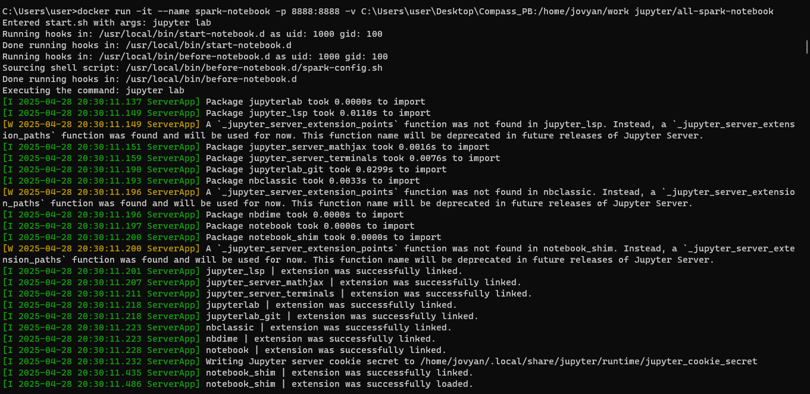
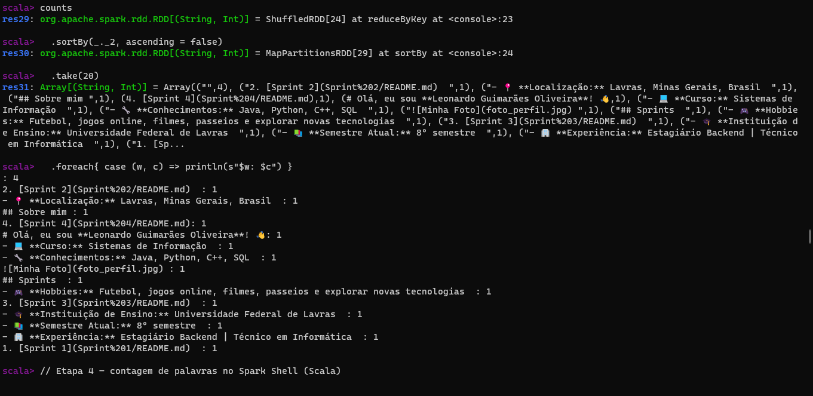
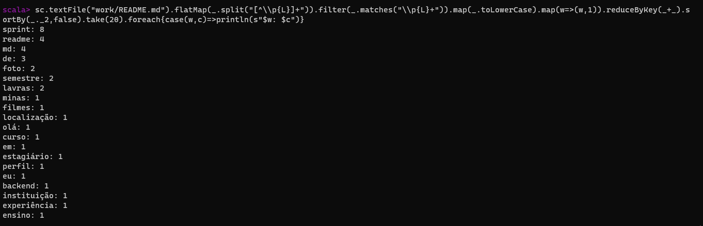
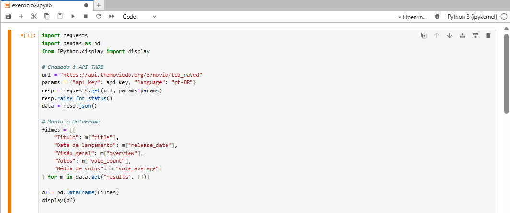
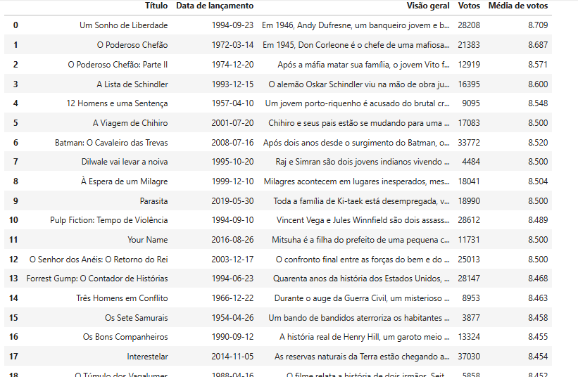

# Instrução  

Este arquivo será o relato da minha entrega. Neste arquivo, faço a organização geral ao longo da Sprint. Aqui serão apresentadas as seções de aprendizado, exercícios e evidências da execução dos códigos.  

---

# Resumo

**Sprint 5 – AWS Data Lake e Spark**: Nesta sprint, aprofundamos conceitos de ingestão e processamento de dados, com ênfase no **curso de Spark** para processamentos distribuídos e na integração de APIs em Python.

- **Ingestão Batch com S3**: automatização do upload de arquivos CSV (`filmes.csv`, `series.csv`) para a camada RAW no Amazon S3, usando Python, boto3 e Docker.
- **Integração de API TMDB**: consumo da API de filmes e séries em um notebook Jupyter; processamento dos resultados em JSON e exibição em DataFrame com pandas.

---

## Introdução ao Desafio

Durante esta sprint realizei também o **Desafio de Filmes e Séries**, cujo objetivo era integrar ingestão batch de CSVs e APIs em um pipeline de Data Lake na AWS. Para detalhes completos, consulte o [README do Desafio](Desafio/README.md).

---

## Exercícios 

### 1 - Processamento com Spark (Scala)
**Enunciado do Exercício:**
> Utilizar o Spark Shell em Scala para processar o arquivo `README.md`, transformá‑lo em RDDs e contar as 20 palavras mais frequentes.

**Objetivo:** aplicar conceitos do curso de Spark ao processamento de texto distribuído.

- **Ambiente:** Spark Shell (Scala) no container Docker Jupyter All-Spark-Notebook.
- **Pipeline de RDDs:**
  1. **Carregamento do arquivo**:
     ```scala
     val text = sc.textFile("work/README.md")
     ```
  2. **Tokenização e limpeza**:
     ```scala
     val words = text
       .flatMap(line => line.split("[^\\p{L}]+"))
       .filter(_.matches("\\p{L}+"))
       .map(_.toLowerCase)
     ```
  3. **Mapeamento e agregação**:
     ```scala
     val counts = words
       .map(w => (w, 1))
       .reduceByKey(_ + _)
     ```
  4. **Ordenação e exibição das 20 palavras mais frequentes**:
     ```scala
     counts
       .sortBy(_._2, ascending = false)
       .take(20)
       .foreach { case (w, c) => println(s"$w: $c") }
     ```

### 2 - Integração de API TMDB em Notebook
**Enunciado do Exercício:**
> Consumir a API TMDB para obter os filmes mais bem avaliados (`top_rated`), processar o JSON resultante e exibir os campos selecionados em um DataFrame no Jupyter Notebook.

**Objetivo:** consumir dados de filmes e séries via API, manipular JSON e apresentar em DataFrame.

- **Ambiente:** Jupyter Notebook dentro do container Docker.
- **Leitura da API:** uso de `requests` para chamar `https://api.themoviedb.org/3/movie/top_rated` com parâmetros `api_key` e `language=pt-BR`.
- **Processamento em pandas:** conversão de `results` JSON para lista de dicionários contendo campos:
  - `Título`, `Data de lançamento`, `Visão geral`, `Votos`, `Média de votos`.
- **Exibição:** criação de `DataFrame` e exibição com `display(df)`.

```python
import os
import requests
import pandas as pd
from IPython.display import display

# API key definida em variável de ambiente ou placeholder
api_key = os.getenv("TMDB_API_KEY", "8d52df1621356b8661dbfe4c159c05db")

# Requisição ao endpoint top_rated
url = "https://api.themoviedb.org/3/movie/top_rated"
params = {"api_key": api_key, "language": "pt-BR"}
resp = requests.get(url, params=params)
resp.raise_for_status()
data = resp.json()

# Conversão para DataFrame
filmes = [{
    "Título": m["title"],
    "Data de lançamento": m["release_date"],
    "Visão geral": m["overview"],
    "Votos": m["vote_count"],
    "Média de votos": m["vote_average"]
} for m in data.get("results", [])]

df = pd.DataFrame(filmes)
display(df)
```

---

## 2. Evidências

1. 📸 – Saída do Spark com top 20 palavras.
2. 📸 – Exercício 1
3. 📸 – Exercício 1
4. 📸 – Exercício 2
5. 📸 – Exercício 2


---

## 3. Conclusão

Nesta sprint, consolidei:

- **Automatização de ingestão** de dados locais para S3.
- **Consumo e manipulação** de APIs em Python no Jupyter.
- **Fundamentos de Spark** aplicados no curso, reforçando processamento distribuído.

---

## 4. Certificados

1. **Fundamentals of Analystics on AWS - Part 1** 
 [Certificado](Certificados/c1.png)
2. **Introduction to Amazon Athena**  
  [Certificado](Certificados/c2.png)
3. **Serverless Analytics**:
   [Certificado](Certificados/c3.png)


