# 🎬 Desafio – Sprint 6

### Etapa 3 – Camada **Trusted** (Filmes de Guerra)

> **Introdução – meu entendimento do desafio**
> O objetivo desta entrega é demonstrar a capacidade de **industrializar** os dados brutos obtidos nas etapas anteriores, construindo uma camada **Trusted** robusta, documentada e pronta para consumo analítico.  Para isso foi elaborado um pipeline em AWS Glue (Spark 3.0) que:
>
> 1. Lê as duas fontes disponíveis (CSV local e JSON da API TMDB) já limitadas ao gênero **Guerra**;
> 2. Converte os datasets para **Parquet** comprimido (*Snappy*), aplicando tipagem explícita;
> 3. Salva os arquivos em S3 particionando por **data de ingestão** (`ano/mes/dia`), o que viabiliza *partition pruning* em Athena e reduz custos;
> 4. Registra automaticamente as tabelas no Glue Data Catalog por meio de um *crawler*;
> 5. Valida o resultado em Athena, gerando evidências de que os requisitos funcionais foram atendidos.

| Item            | Valor                                          |
| --------------- | ---------------------------------------------- |
|                            |
| **Bucket**      | `s3://data-leak-leonardo`                      |
| **Região**      | us‑east‑1                                      |
| **Ferramentas** | AWS Glue ETL (Spark 3.0), Glue Crawler, Athena |

---

## 0️⃣  Visão geral

```text
RAW  ─┬─▶ GLUE JOB 1 (CSV → Parquet)  ─▶ Trusted/Local/Parquet/Movies/
      └─▶ GLUE JOB 2 (JSON → Parquet) ─▶ Trusted/TMDB/Parquet/Movies/
                                             ▲
                                     GLUE CRAWLER
                                             ▲
                                           ATHENA
```

* **Formato final:** Parquet.
* **Particionamento:** `ano=YYYY/mes=MM/dia=DD` – data de ingestão.
* **Escopo:** Somente filmes cujo campo `genero` contém “War”.

---

## 1️⃣  Criação do *Database* Trusted

| Ação                             | Detalhe                                                                | Evidência      |
| -------------------------------- | ---------------------------------------------------------------------- | -------------- |
| Glue Console → *Databases ▸ Add* | Nome **`movies_trusted_db`** | 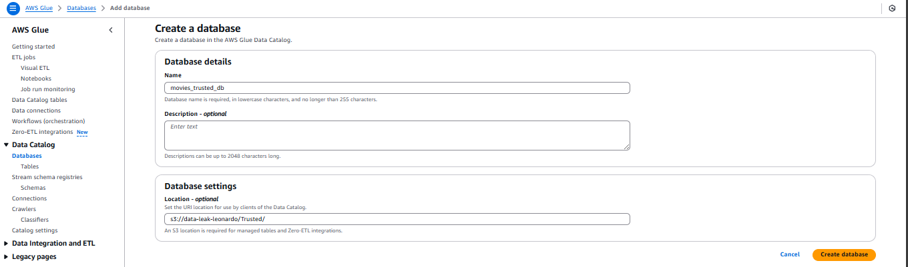 |

**Por que foi adotado?**
Um banco exclusivo evita colisões de schema com as tabelas da Raw Zone manipuladas nas etapas anteriores.

---

## 2️⃣  Crawlers Trusted

Nesta etapa foram criados **dois** crawlers independentes – um para a origem **Local CSV** já convertida para Parquet e outro para o conjunto **TMDB**.  Segregar os crawlers facilita a manutenção (por exemplo, caso a granularidade de partição mude apenas em uma das fontes).

### 2.1 Crawler `crawler_trusted_local_movies`

| Configuração | Valor                                                   |
| ------------ | ------------------------------------------------------- |
| Origem S3    | `s3://data-leak-leonardo/Trusted/Local/Parquet/Movies/` |
| Database     | `movies_trusted_db`                                     |
| Schedule     | Manual                                                  |

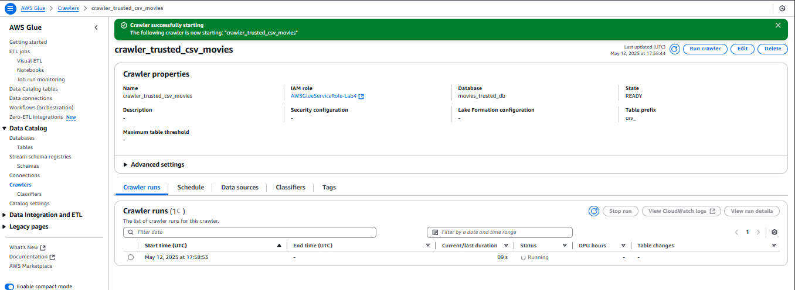

### 2.2 Crawler `crawler_trusted_tmdb_movies`

| Configuração | Valor                                                  |
| ------------ | ------------------------------------------------------ |
| Origem S3    | `s3://data-leak-leonardo/Trusted/TMDB/Parquet/Movies/` |
| Database     | `movies_trusted_db`                                    |
| Schedule     | Manual                                                 |

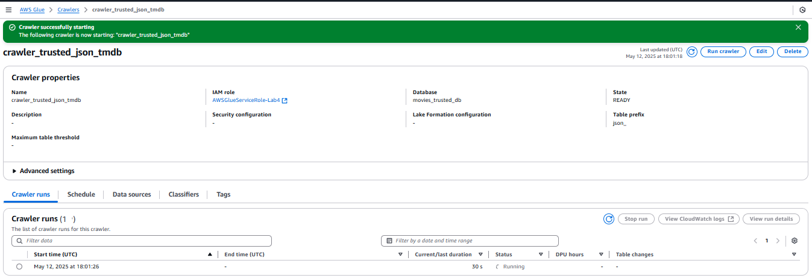

**Justificativa para separação**
Cada dataset pode evoluir isoladamente (novas partições, layout de schema).  Manter crawlers dedicados evita reprocessar a árvore completa quando apenas uma fonte recebe novos lotes.

---
---

## 3️⃣  Job Glue #1 – CSV **Local** → Trusted

### 3.1 Parâmetros principais

| Parâmetro          | Valor                                  |
| ------------------ | -------------------------------------- |
| `RAW_CSV_PATH`     | `s3://…/Raw/Local/CSV/Movies/`         |
| `TRUSTED_CSV_PATH` | `s3://…/Trusted/Local/Parquet/Movies/` |
| Worker type        | `G.1X`, 2 workers                      |
| Timeout            | 60 min                                 |

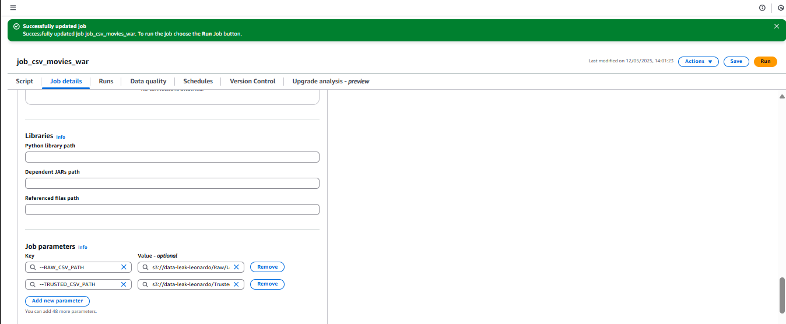


### 3.2 Decisões tomadas

| Etapa                              | Justificativa                                                                        |
| ---------------------------------- | ------------------------------------------------------------------------------------ |
| Leitura recursiva + `multiLine`    | Garante ingestão de todos os CSVs em subpastas e suporta descrições multilinha.      |
| Filtro `genero LIKE '%War%'`       | Atende diretamente ao escopo “filmes de guerra”.                                     |
| Conversão de tipos                 | Permite cálculos (ex.: duração média) sem *cast* em runtime.                         |
| Particionamento pela data corrente | Reflete a **data de ingestão**, conforme exigido no enunciado.                       |


### 3.3 Script utilizado

```python
import sys
from awsglue.utils import getResolvedOptions
from pyspark.sql import SparkSession, functions as F
from awsglue.context import GlueContext
from awsglue.job import Job

args = getResolvedOptions(
    sys.argv,
    ['JOB_NAME', 'RAW_CSV_PATH', 'TRUSTED_CSV_PATH']
)

spark = SparkSession.builder.getOrCreate()
glueContext = GlueContext(spark.sparkContext)
job = Job(glueContext)
job.init(args['JOB_NAME'], args)

# 1) Lê todos os CSV separados por |
df = (spark.read
        .option("header", "true")
        .option("delimiter", "|")
        .option("recursiveFileLookup", "true")
        .csv(args['RAW_CSV_PATH']))

# 2) Mantém só filmes cujo campo "genero" contém 'War'
df_war = df.filter(F.col("genero").contains("War"))

# 3) Converte colunas numéricas
df_war = (df_war
          .withColumn("anoLancamento", F.col("anoLancamento").cast("int"))
          .withColumn("tempoMinutos", F.col("tempoMinutos").cast("int"))
          .withColumn("notaMedia",   F.col("notaMedia").cast("double"))
          .withColumn("numeroVotos", F.col("numeroVotos").cast("int")))

# 4) Adiciona colunas de partição (data de ingestão = hoje)
hoje = F.current_date()
df_war = (df_war
          .withColumn("ano", F.year(hoje))
          .withColumn("mes", F.date_format(hoje, "MM"))
          .withColumn("dia", F.date_format(hoje, "dd")))

# 5) Grava em Parquet particionado ano/mes/dia
(df_war.write
      .mode("overwrite")
      .partitionBy("ano", "mes", "dia")
      .parquet(args['TRUSTED_CSV_PATH']))

job.commit()
```
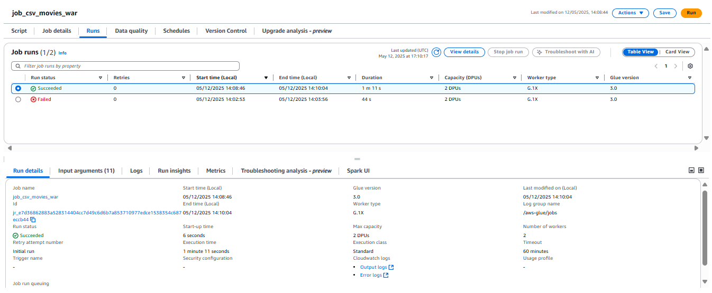


### 3.4 Estrutura gerada no S3

```
Trusted/Local/Parquet/Movies/
└─ ano=2025/mes=05/dia=12/part-0000.snappy.parquet
```


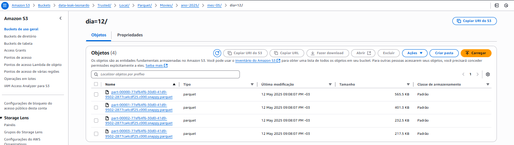
---

## 4️⃣  Job Glue #2 – JSON **TMDB** → Trusted

### 4.1 Parâmetros principais

| Parâmetro           | Valor                                 |
| ------------------- | ------------------------------------- |
| `RAW_JSON_PATH`     | `s3://…/Raw/TMDB/JSON/Movies/`        |
| `TRUSTED_JSON_PATH` | `s3://…/Trusted/TMDB/Parquet/Movies/` |

### 4.2 Decisões tomadas 

| Etapa                                         | Justificativa                                                                 |
|-----------------------------------------------|-------------------------------------------------------------------------------|
| Leitura recursiva                             | Os arquivos JSON são gerados em subpastas diárias pela ingestão da API.      |
| Preservação de arrays (`cast`, `directors`)   | Mantém flexibilidade para explodir no Curated; não há requisito de removê‑los.|
| Particionamento pela **data de ingestão (path)** | A data `ano/mes/dia` foi extraída do prefixo Raw (`/YYYY/MM/DD/`), atendendo ao enunciado. |


#### Script utilizado

```python
import sys, re
from awsglue.utils import getResolvedOptions
from pyspark.sql import SparkSession, functions as F
from awsglue.context import GlueContext
from awsglue.job import Job

args = getResolvedOptions(sys.argv,
    ['JOB_NAME', 'RAW_JSON_PATH', 'TRUSTED_JSON_PATH'])

spark = SparkSession.builder.getOrCreate()
glueContext = GlueContext(spark.sparkContext)
job = Job(glueContext)
job.init(args['JOB_NAME'], args)

#Lê todos os JSONs da RAW
df = (spark.read
      .option("recursiveFileLookup", "true")   
      .json(args['RAW_JSON_PATH']))

# Extrai ano/mes/dia do path do arquivo
df = (df
      .withColumn("ano", F.regexp_extract(F.input_file_name(), r'/(\d{4})/', 1))
      .withColumn("mes", F.regexp_extract(F.input_file_name(), r'/\d{4}/(\d{2})/', 1))
      .withColumn("dia", F.regexp_extract(F.input_file_name(), r'/\d{4}/\d{2}/(\d{2})/', 1)))

# Salva em Parquet particionado
(df.write
    .mode("overwrite")
    .partitionBy("ano", "mes", "dia")
    .parquet(args['TRUSTED_JSON_PATH']))

job.commit()

```

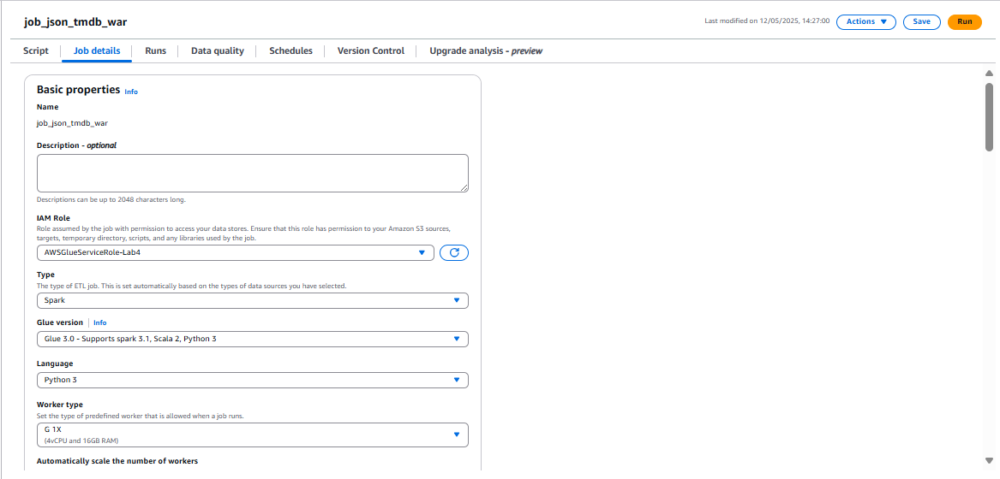
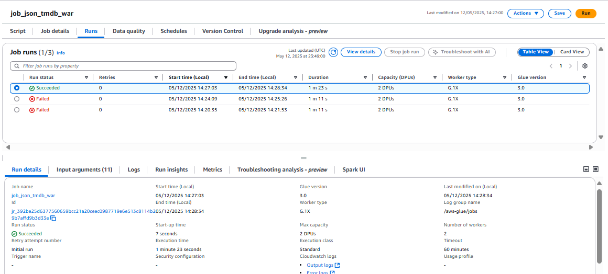
### 4.3 Estrutura gerada no S3

```
Trusted/TMDB/Parquet/Movies/
└─ ano=2025/mes=05/dia=12/part-0000.snappy.parquet
```

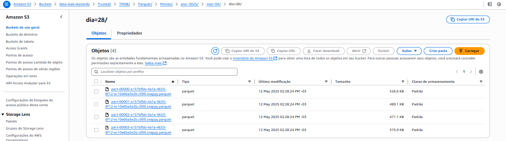

---

## 5️⃣  Execução do Crawler 

Após a conclusão dos jobs o crawler foi executado, criando/atualizando as tabelas:

| Tabela        | Particionada        | 
| ------------- | ------------------- | 
| `csv_movies`  | Sim (ano, mes, dia) |
| `json_movies` | Sim (ano, mes, dia) |

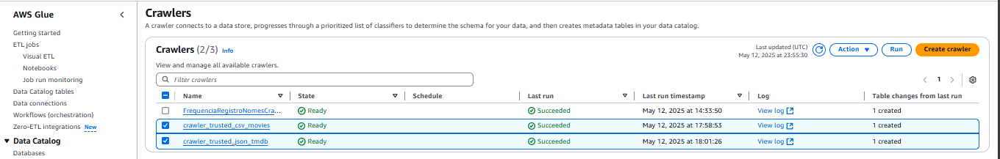
---

## 6️⃣  Validação em Athena

### 6.1 CSV

```sql
SELECT *
FROM   movies_trusted_db.csv_movies
LIMIT 10;
```

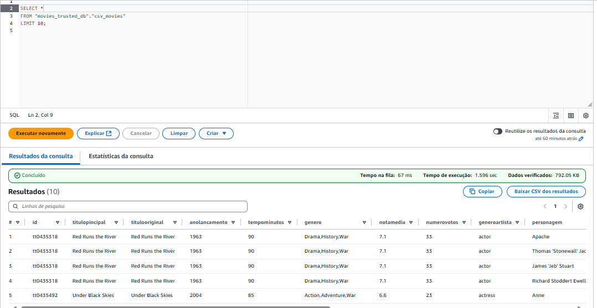

### 6.2 JSON 

```sql
SELECT
    imdb_id,
    tmdb_id,
    array_join(directors, ', ') AS diretores,
    array_join(production_companies, ', ') AS produtoras,
    overview,
    ano,
    mes,
    dia
FROM  "movies_trusted_db"."json_movies"
ORDER BY ano DESC, mes DESC, dia DESC
LIMIT 20
```

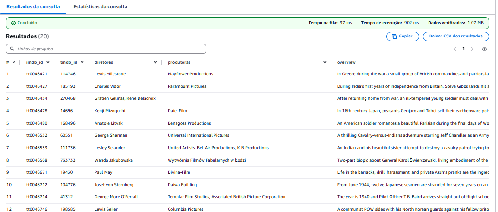


---


