# Instrução

Este arquivo será o relato da minha entrega. Neste documento, faço a organização geral ao longo da Sprint 6. Aqui são apresentadas as seções de aprendizado, exercícios e evidências da execução dos códigos.

---

# Resumo

**Sprint 6 – Geração de Dados em Python e Processamento com PySpark**: Nesta sprint, aprofundamos:

* **Manipulação de Dados em Python**: geração de listas aleatórias, ordenação e escrita de arquivos texto.
* **Processamento Distribuído com PySpark**: leitura de dados em DataFrame, uso de DataFrame API e Spark SQL para transformações, filtros e agregações.

---

## Desafio de Filmes e Séries

Nesta sprint, executei a **Entrega 3** do Desafio de Filmes e Séries, focando no processamento da camada Trusted com AWS Glue:

* Job AWS Glue em PySpark para ingestão de arquivos CSV da Raw Zone;
* Aplicação de transformações e padronizações de schema;
* Escrita em formato Parquet particionado por data de ingestão;
* Registro automático do catálogo no AWS Glue Data Catalog para consultas via Athena.

Para detalhes completos, consulte o [README do desafio](Desafio/README.md).

## Exercícios

### 1 - Python: Geração e Manipulação de Listas

**Enunciado (Parte 1):**

> 1. Gere uma lista com 250 inteiros aleatórios e inverta a ordem.
> 2. Crie uma lista com 20 nomes de animais, ordene alfabeticamente e salve em `animais.txt`.
> 3. Baixe e use o pacote `names` para gerar 39.080 nomes únicos, em seguida crie 1.000.000 de nomes aleatórios a partir dessa lista e salve em `nomes_aleatorios.txt`.

**Objetivo:** praticar geração de dados, métodos de lista, e escrita de arquivos em Python.

### 2 - PySpark: Processamento Distribuído

**Enunciado (Parte 2):**

> 1. Ler o arquivo `nomes_aleatorios.txt` em um DataFrame (`df_nomes`).
> 2. Renomear a coluna para `Nomes`, imprimir schema e mostrar as 10 primeiras linhas.
> 3. Adicionar coluna `Escolaridade` (Fundamental, Medio ou Superior) aleatória.
> 4. Adicionar coluna `Pais` (um dos 13 países da América do Sul) aleatória.
> 5. Adicionar coluna `AnoNascimento` entre 1945 e 2010 aleatória.
> 6. Com DataFrame API, selecionar nomes de pessoas nascidas em ou após 2001.
> 7. Repetir a consulta do passo 6 usando Spark SQL.
> 8. Contar quantas pessoas são Millennials (1980–1994) com DataFrame API.
> 9. Repetir a contagem do passo 8 com Spark SQL.
> 10. Com Spark SQL, agregar e mostrar a quantidade de pessoas por país e geração (Baby Boomers, Geração X, Millennials, Geração Z).

**Objetivo:** consolidar uso de PySpark para leitura, transformação e consulta de grandes volumes de dados.

---

## 2. Evidências

1. 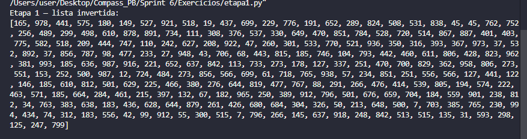
2. 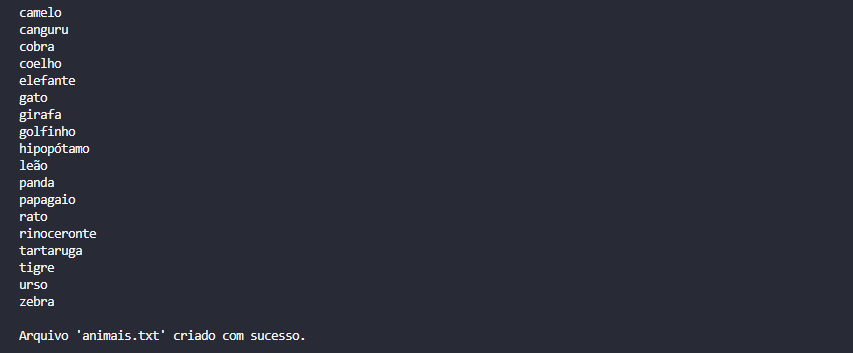
3. 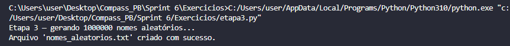
4. 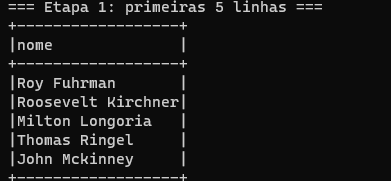
5. 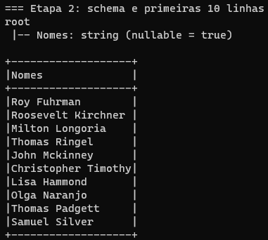
6. 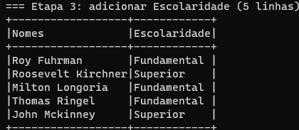
7. 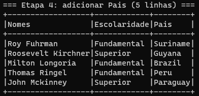
8. 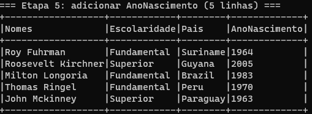
9. 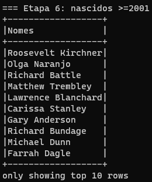
10. 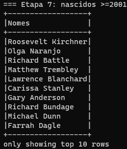
11. 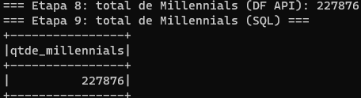
12. 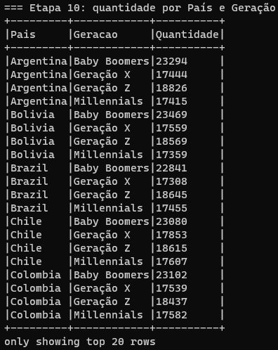

## 3. AWS Glue Lab

No laboratório de AWS Glue, executei um processo ETL simplificado:

* Preparei um bucket no S3 e carreguei o arquivo `nomes.csv`.
* Criei uma IAM Role (`AWSGlueServiceRole-Lab4`) com permissões necessárias para S3, Lake Formation e Glue.
* Configurei o banco de dados `glue-lab` no Lake Formation para catalogar dados.
* Desenvolvimento de um job Glue em Python Spark para ler o CSV, transformar dados (uppercase, contagens e agregações por ano e sexo) e gravar resultados em JSON particionado em S3.
* Criação de um Crawler para registrar a tabela `frequencia_registro_nomes_eua` no Glue Catalog.

### Evidências do AWS Glue Lab

1. 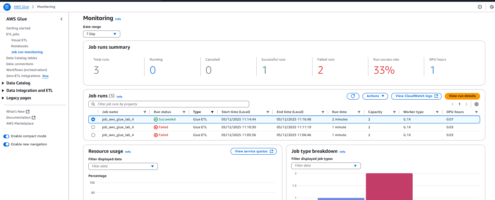
2. 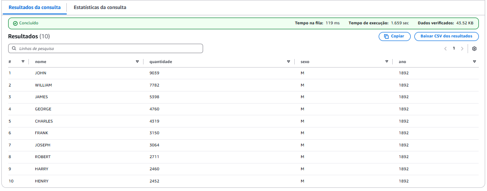

---

## 4. Conclusão

Nesta sprint, consolidei:

* A geração e manipulação de dados em Python, incluindo métodos de lista, seeds de aleatoriedade e escrita de arquivos.
* O uso de PySpark em modo local para criar DataFrames, aplicar transformações sem loops explícitos e realizar consultas com DataFrame API e Spark SQL.
* Criar soluções escaláveis para grandes volumes de dados.

---

## 4. Certificados
1.
 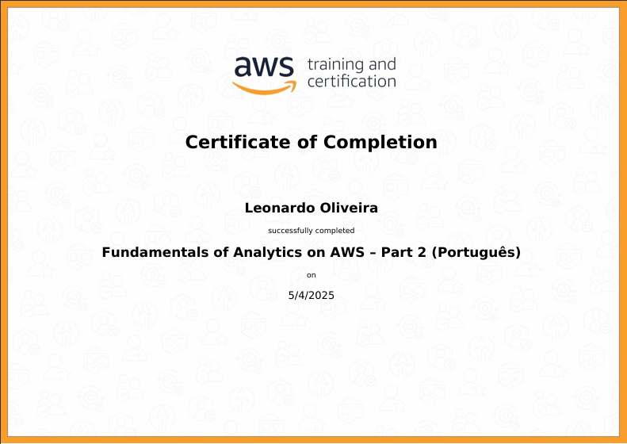
2.   
  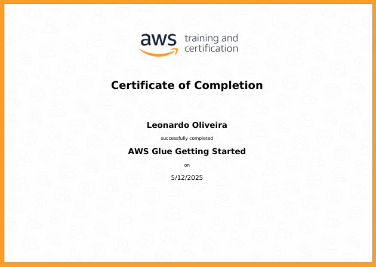
