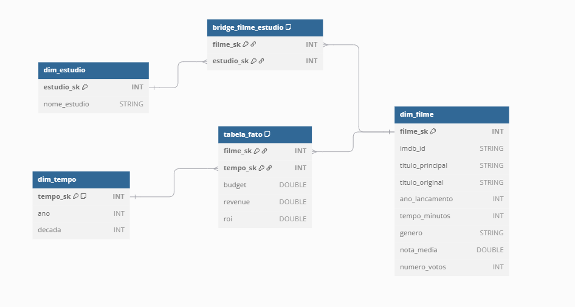
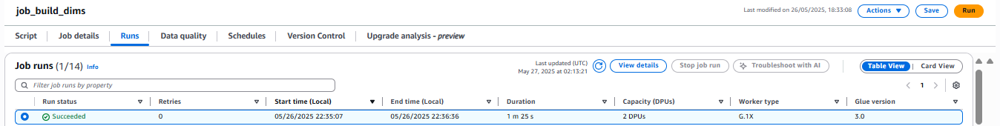
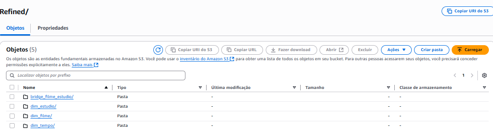
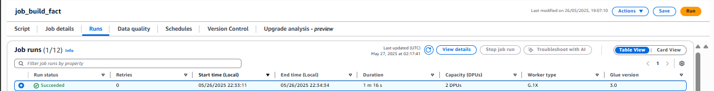
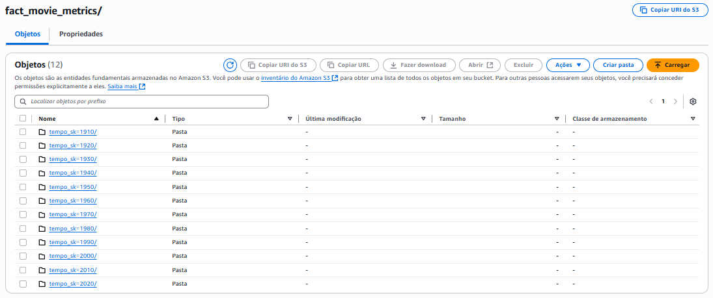
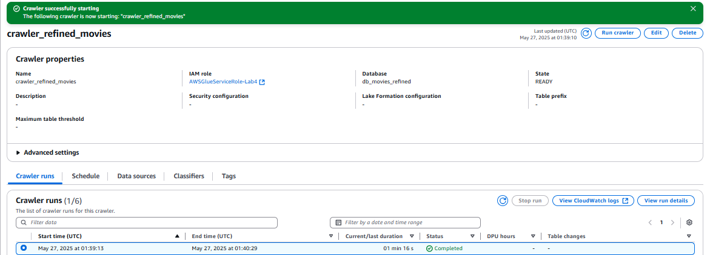
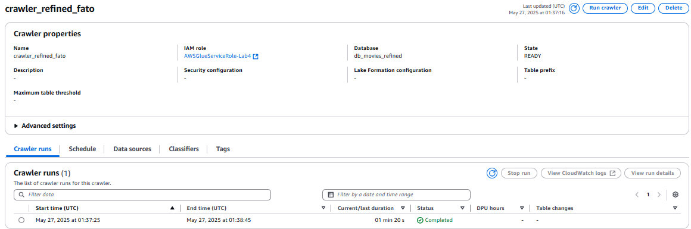
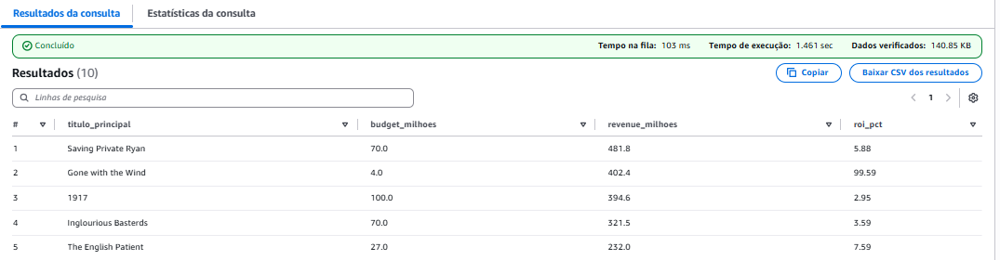

# 🎬 Desafio – Sprint 7

### Camada **Refined**

---

## 0️⃣ Objetivo da Sprint

Esta etapa foca em **modelar** e **popular** a camada **Refined** do data lake, transformando os dados confiáveis da Trusted-Zone num **modelo dimensional** de fácil consumo analítico (QuickSight, Athena, etc.).

**Principais metas**

| # | Meta | Onde está documentado |
|---|------|-----------------------|
| 1 | Desenhar o modelo de dados da Refined (Star Schema) | Seção 1 |
| 2 | Construir jobs Glue que materializam todas as dimensões, bridges e fato | Seções 2 & 3 |
| 3 | Registrar as tabelas no Glue Data Catalog via Crawlers | Seção 4 |
| 4 | Validar com queries SQL  | Seção 5 |


---

## 1️⃣ Modelagem Dimensional  

### 1.1 Visão conceitual



> **Legenda**  
> • Chaves primárias sublinhadas  
> • Bridges = tabelas associativas para relacionamentos **m:n**   

### 1.2 Tabelas e justificativas

| Tabela | Grão | Por que existe? | Observações |
|--------|------|-----------------|-------------|
| `dim_filme` | 1 linha por **filme** | Contém atributos descritivos (título, gênero, duração, nota…) | Usa um **surrogate key** `filme_sk` (int) para estabilidade; `imdb_id` pode mudar/ficar nulo. |
| `dim_estudio` | 1 linha por **estúdio** | Permite analisar receita por produtora | Inseri surrogate `estudio_sk` e removi a lista de estúdios da fato. |
| `dim_tempo` | 1 linha por **ano** | Dimensão temporal clássica |  Só o nível *ano* foi usado; derivei também `decada`. |
| `bridge_filme_estudio` | Várias linhas | Resolve relação **N:M** entre filmes e estúdios | Chave primária **composta** `(filme_sk, estudio_sk)`◆ garante unicidade. |
| `fact_movie_metrics` | 1 linha por **filme × ano** | Guarda métricas **numéricas** (budget, revenue, ROI) | PK composta `(filme_sk, tempo_sk)`◆.  Mantive apenas números para não violar boas práticas de DW. |

◆ **Decisão importante** – Feedback da Sprint anterior apontou problemas de:
* **Campos não-numéricos** na fato ➜ removidos;
* **FKs baseadas em chaves naturais compostas** ➜ substituídas por IDs surrogados + bridges.

---

## 2️⃣ Job #1 – `job_build_dims.py`   *(Dimensões)*

> Caminho final em S3  
> `s3://data-leak-leonardo/Refined/bridge_filme_estudio/`

### 2.1 Fluxo resumido
1. **Lê** o Parquet do **CSV local** (Trusted)  
2. Constrói **`dim_filme`** (gera surrogate key por `row_number`)  
3. **Transforma** `production_companies` do JSON TMDB ⇒ `dim_estudio`  
4. Cria a **bridge filme_estudio**  
5. Deriva **anos/décadas** do `created_at` do TMDB ⇒ `dim_tempo`  
6. **Grava** todas as tabelas particionadas (dim)  

### 2.2 Código 

```python
import sys, re
from awsglue.utils import getResolvedOptions
from pyspark.sql import SparkSession, functions as F, types as T
from pyspark.sql import Window
from awsglue.context import GlueContext
from awsglue.job import Job

#parâmetros do Glue 
args = getResolvedOptions(
    sys.argv,
    ["JOB_NAME", "TRUSTED_CSV_PATH", "TRUSTED_JSON_PATH", "REFINED_PATH"]
)

#  sessão Spark / Glue
spark = SparkSession.builder.getOrCreate()
glue_ctx = GlueContext(spark.sparkContext)
job = Job(glue_ctx)
job.init(args["JOB_NAME"], args)

refined_root = re.sub(r"/?$", "/", args["REFINED_PATH"].strip())


# 1. DIM_FILME 
df_csv = (
    spark.read
         .option("recursiveFileLookup", "true")
         .parquet(args["TRUSTED_CSV_PATH"])
         .select(
             F.col("id").alias("imdb_id"),
             F.col("tituloPincipal").alias("titulo_principal"),
             F.col("tituloOriginal").alias("titulo_original"),
             F.col("anoLancamento").cast("int").alias("ano_lancamento"),
             F.col("tempoMinutos").cast("int").alias("tempo_minutos"),
             "genero",
             F.col("notaMedia").cast("double").alias("nota_media"),
             F.col("numeroVotos").cast("int").alias("numero_votos"),
         )
)

dim_filme = (
    df_csv.dropDuplicates(["imdb_id"])
          .withColumn("filme_sk", F.row_number().over(Window.orderBy("imdb_id")))
)

(dim_filme.write
         .mode("overwrite")
         .parquet(f"{refined_root}dim_filme/"))

# 2. DIM_ESTUDIO  +  BRIDGE_FILME_ESTUDIO  (fonte JSON TMDB)

# lemos apenas as colunas necessárias
df_json = (
    spark.read
         .option("recursiveFileLookup", "true")
         .parquet(args["TRUSTED_JSON_PATH"])
         .select("imdb_id", "production_companies")
         .filter(F.col("imdb_id").isNotNull())
)

# Produz um array de strings
studios_inter = (
    df_json
      .withColumn(
          "pc_array",
          F.when(                               # se já for ARRAY -> mantém
              F.col("production_companies").cast("array<string>").isNotNull(),
              F.col("production_companies").cast("array<string>")
          )
          # senão… considera que é STRING no formato "[A, B, C]"
          .otherwise(
              F.split(
                  F.regexp_replace(
                      F.col("production_companies").cast("string"),
                      r"^\[|\]$", ""
                  ),
                  r"\s*,\s*"
              )
          )
      )
      .select("imdb_id", F.explode_outer("pc_array").alias("nome_estudio_raw"))
      .withColumn("nome_estudio", F.trim("nome_estudio_raw"))
      .filter(F.col("nome_estudio") != "")
      .select("imdb_id", "nome_estudio")
)

#dim_estudio 
dim_estudio = (
    studios_inter.select("nome_estudio")
                 .dropDuplicates()
                 .withColumn(
                     "estudio_sk",
                     F.row_number().over(Window.orderBy("nome_estudio"))
                 )
)

(dim_estudio.write
            .mode("overwrite")
            .parquet(f"{refined_root}dim_estudio/"))

#── bridge filme × estúdio ────────────────────────────────────────────────────
bridge_filme_estudio = (
    studios_inter
        .join(dim_filme,  "imdb_id")
        .join(dim_estudio, "nome_estudio")
        .select("filme_sk", "estudio_sk")
        .dropDuplicates()
)

(bridge_filme_estudio.write
                     .mode("overwrite")
                     .parquet(f"{refined_root}bridge_filme_estudio/"))


# 3. DIM_TEMPO (por DÉCADA a partir do ano_lancamento)

decadas_df = (
    df_csv.select("ano_lancamento")
          .where("ano_lancamento IS NOT NULL AND ano_lancamento > 1800")
          .withColumn("decada", (F.col("ano_lancamento")/10).cast("int")*10)
          .select("decada")
          .dropDuplicates()
)

dim_tempo = (
    decadas_df
      .withColumn("tempo_sk", F.col("decada"))
      .select("tempo_sk", "decada")
      .orderBy("decada")
)

(dim_tempo.write
          .mode("overwrite")
          .parquet(f"{refined_root}dim_tempo/"))

job.commit()

````

### 2.3 Evidências

| # | Descrição                             | Print                                         |
| - | ------------------------------------- | --------------------------------------------- |
| 1 | Execução do job no Glue (console)     |  |
| 2 | Pastas criadas em `Refined/`          |   |


---

## 3️⃣ Job #2 – `job_build_fact.py`   *(Fato)*

> Caminho final em S3
> `s3://data-leak-leonardo/Refined/fact_movie_metrics/`

```python
import sys
from awsglue.utils import getResolvedOptions
from pyspark.sql import SparkSession, functions as F
from awsglue.context import GlueContext
from awsglue.job import Job

# parâmetros 
args = getResolvedOptions(
    sys.argv,
    ['JOB_NAME',
     'REFINED_PATH',          
     'TRUSTED_JSON_PATH',      
     'REFINED_FACT_PATH']     
)

spark = SparkSession.builder.getOrCreate()
glue  = GlueContext(spark.sparkContext)
job   = Job(glue)
job.init(args['JOB_NAME'], args)

dim_filme = spark.read.parquet(f"{args['REFINED_PATH']}/dim_filme/")
dim_tempo = spark.read.parquet(f"{args['REFINED_PATH']}/dim_tempo/")

#2. lê métricas
df_json = (spark.read
           .option("recursiveFileLookup", "true")
           .parquet(args['TRUSTED_JSON_PATH'])
           .select("imdb_id",
                   F.col("budget").cast("double").alias("budget"),
                   F.col("revenue").cast("double").alias("revenue"))
           .filter("imdb_id IS NOT NULL"))

# 3. monta fato básica 
fact = (df_json.alias("j")
        .join(dim_filme.alias("f"), "imdb_id")# fk filme
        .withColumn("decada", (F.col("ano_lancamento")/10).cast("int")*10)
        .join(dim_tempo.alias("t"), "decada", "left")  # fk tempo
        .select(F.col("f.filme_sk"),
                F.col("t.tempo_sk"),
                "budget", "revenue")  
        )

fact = (fact
        .withColumn("budget",
                    F.when(F.col("budget")==0,   None).otherwise(F.col("budget")))
        .withColumn("revenue",
                    F.when(F.col("revenue")==0,  None).otherwise(F.col("revenue")))
        .withColumn("roi",
                    F.when(F.col("budget").isNotNull() & (F.col("budget")>0),
                           (F.col("revenue")-F.col("budget"))/F.col("budget")))
       )

# ────────────────────────── 4. grava fato ───────────────────────
(fact.write
     .mode("overwrite")
     .partitionBy("tempo_sk")
     .parquet(args['REFINED_FACT_PATH']))

job.commit()

```

| Evidência                             | Print                                            |
| ------------------------------------- | ------------------------------------------------ |
| Execução bem-sucedida                 |     |
| Arquivos particionados por `tempo_sk` |     |


---

## 4️⃣ Crawlers Refined

| Crawler                | Path                          | Tables criadas       | Evidência                                 |
| ---------------------- | ----------------------------- | -------------------- | ----------------------------------------- |
| `crawler_refined_dims` | `Refined/*dim_*`              | 3 dimensões + bridge |   |
| `crawler_refined_fact` | `Refined/fact_movie_metrics/` | `fact_movie_metrics` |   |

*Mantive crawlers separados para evitar re-scan completo ao atualizar apenas a fato.*

---

## 5️⃣ Validação SQL (Athena)


```sql
SELECT d.titulo_principal,
       ROUND(m.budget / 1e6, 1)  AS budget_milhoes,
       ROUND(m.revenue/ 1e6, 1)  AS revenue_milhoes,
       ROUND(m.roi   , 2)        AS roi_pct
FROM   fact_movie_metrics  m
JOIN   dim_filme          d
       ON d.filme_sk = m.filme_sk
ORDER  BY revenue_milhoes DESC
LIMIT  10;

```
 

###  Consultas-exemplo (**as 4 análises** escolhidas)

| # | Questão de negócio                                | Exemplo SQL                                                                                                                                                                                    |
| - | ------------------------------------------------- | ---------------------------------------------------------------------------------------------------------------------------------------------------------------------------------------------- |
| 1 | **Qual ROI médio por década?**                    | `SELECT decada, ROUND(AVG(roi),2) FROM fact_movie_metrics JOIN dim_tempo USING (tempo_sk) GROUP BY decada ORDER BY decada;`                                                                    |
| 2 | **Top 10 filmes por ROI**                         | `SELECT titulo_principal, roi FROM fact_movie_metrics JOIN dim_filme USING(filme_sk) ORDER BY roi DESC LIMIT 10;`                                                                              |
| 3 | **Estúdios com maior revenue acumulado**          | `SELECT nome_estudio, SUM(revenue) FROM fact_movie_metrics f JOIN bridge_filme_estudio b USING(filme_sk) JOIN dim_estudio e USING(estudio_sk) GROUP BY nome_estudio ORDER BY 2 DESC LIMIT 10;` |
|
| 4 | **Duração média dos filmes de guerra por década** | `SELECT decada, ROUND(AVG(tempo_minutos),1) FROM fact_movie_metrics f JOIN dim_filme d USING(filme_sk) JOIN dim_tempo t USING(tempo_sk) GROUP BY decada ORDER BY decada;` |

---

## 6️⃣ Decisões de Design & Boas Práticas usadas

1. **Surrogate keys** garantem imutabilidade mesmo se `imdb_id` ou nomes de estúdio mudarem.
2. **Bridge table** resolve a cardinalidade **muitos-para-muitos** sem inflar a fato com duplicidade de métricas.
3. **Fato somente numérica** – removi qualquer descrição (*third normal form* dentro da dimensão).
4. **Particionamento por ano (`tempo_sk`)** → consultas históricas performam *partition-pruning*.

---


