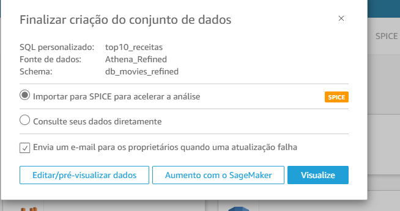
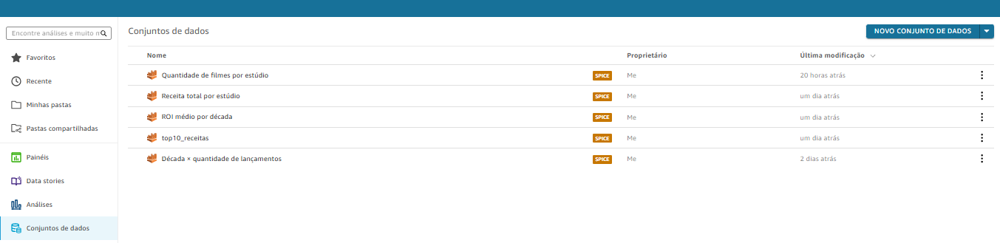
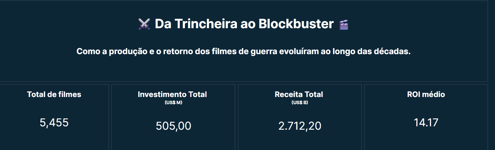
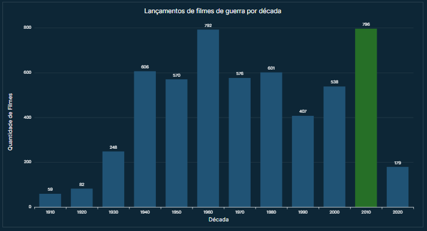
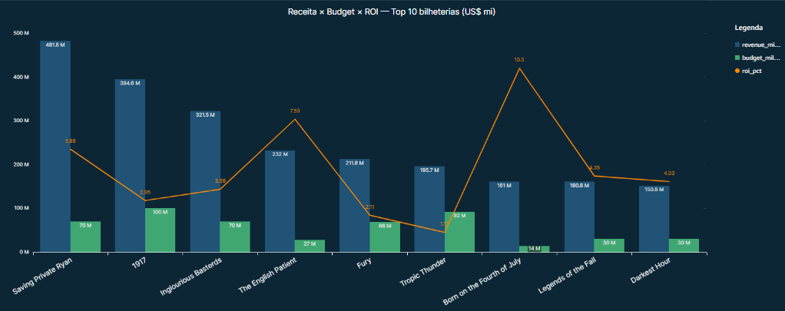
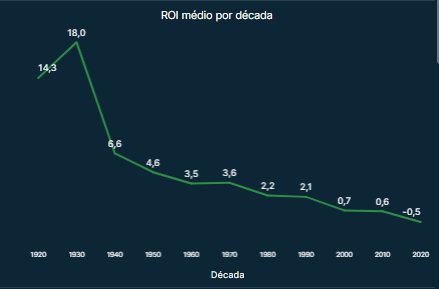
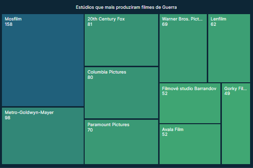
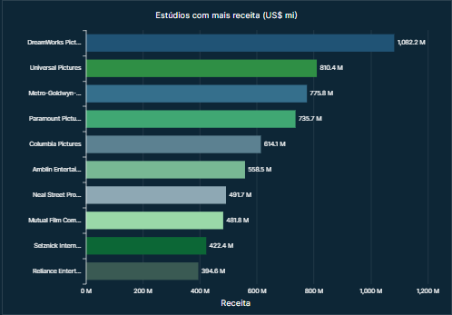
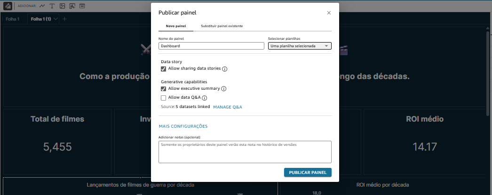

# Sprint 8 – Consumo dos dados (Dashboard QuickSight)

> 🚩 **Objetivo da entrega**  
> Criar um dashboard no **AWS QuickSight** (fonte única: camada **Refined** no Data Lake) para responder às perguntas da análise sobre filmes de guerra.

---

## 0 . Pré-requisitos

* Camada **Refined** populada (dimensões, fato) 
* Tabelas catalogadas no Glue e acessíveis via **Athena** (`db_movies_refined`).  
* Permissões de author no QuickSight + conector Athena habilitado.

---

## 1 . Perguntas da análise

| # | Pergunta | Métrica-chave |
|---|----------|---------------|
| 1 | Em que década houve mais lançamentos de filmes de guerra? | qtd de filmes |
| 2 | Quais são os **10** filmes de guerra com maior receita (incluindo orçamento e ROI)? | Receita × Budget × ROI |
| 3 | Como o ROI médio evoluiu ao longo das décadas? | ROI médio |
| 4 | Quais estúdios geraram a maior receita em filmes de guerra? | Receita total |
| 5 | Quais estúdios mais produziram filmes de guerra? | qtd de filmes |

Essas perguntas geram **cinco datasets** e seis visuais (um KPI extra para total de filmes).

---

## 2 . Criação dos datasets no QuickSight

1. **Fonte de dados:**  
   *Novo* → **Athena** → nome *Athena_Refined* → catálogo **AwsDataCatalog** → banco `db_movies_refined`.

2. **Datasets SQL personalizados** – marque **“Importar para SPICE”**.

| Dataset | SQL (resumo) |
|---------|--------------|
| `filmes_por_decada` | ```SELECT t.decada, COUNT(*) qtd_filmes FROM dim_filme f JOIN dim_tempo t ON f.ano_lancamento BETWEEN t.decada AND t.decada+9 WHERE f.genero LIKE '%War%' GROUP BY t.decada``` |
| `top10_receitas` | ```SELECT d.titulo_principal, ROUND(m.revenue/1e6,1) revenue_milhoes, ROUND(m.budget/1e6,1) budget_milhoes, ROUND(m.roi,2) roi_pct FROM fact_movie_metrics m JOIN dim_filme d ON d.filme_sk = m.filme_sk WHERE d.genero LIKE '%War%' ORDER BY revenue_milhoes DESC LIMIT 10``` |
| `roi_por_decada` | ```SELECT t.decada, ROUND(AVG(m.roi),2) roi_medio FROM fact_movie_metrics m JOIN dim_filme f ON f.filme_sk = m.filme_sk JOIN dim_tempo t ON m.ano_lancamento = t.decada WHERE f.genero LIKE '%War%' GROUP BY t.decada ORDER BY t.decada``` |
| `receita_por_estudio` | ```SELECT e.nome_estudio, ROUND(SUM(m.revenue)/1e6,1) receita_milhoes FROM fact_movie_metrics m JOIN bridge_filme_estudio b ON b.filme_sk = m.filme_sk JOIN dim_estudio e ON e.estudio_sk = b.estudio_sk JOIN dim_filme f ON f.filme_sk = m.filme_sk WHERE f.genero LIKE '%War%' GROUP BY e.nome_estudio ORDER BY receita_milhoes DESC LIMIT 10``` |
| `filmes_por_estudio` | ```SELECT e.nome_estudio, COUNT(*) qtd_filmes FROM bridge_filme_estudio b JOIN dim_estudio e ON e.estudio_sk = b.estudio_sk JOIN dim_filme f ON f.filme_sk = b.filme_sk WHERE f.genero LIKE '%War%' GROUP BY e.nome_estudio ORDER BY qtd_filmes DESC LIMIT 10``` |

> **Evidências**: 





---

## 3 . Construção do dashboard

### 3.1 Paleta & boas-práticas
| Elemento | Cor/estilo |
|----------|------------|
| Background | #FFFFFF (clean) |
| Receita | Azul-claro `#A3D5FF` |
| Budget  | Azul-escuro `#004B6E` |
| ROI     | Laranja `#FFB347` |
| Fonte   | Amazon Ember, 14 px (tit.), 11 px (labels) |

> **Storytelling**: fluxo “Produção → Desempenho financeiro → ROI → Estúdios”.

### 3.2 Visuais adotados

| #     | Título                                          | Tipo de gráfico                  | Campos principais                                                                                    | Configurações-chave                                                                                                   |
| ----- | ----------------------------------------------- | -------------------------------- | ---------------------------------------------------------------------------------------------------- | --------------------------------------------------------------------------------------------------------------------- |
| **1** | **Lançamentos por década**                      | Coluna vertical                  | **Eixo X** `decada_txt` · **Valor** `countDistinct(filme_sk)`                                        | Ordenar asc.; barra campeã em verde; rótulos internos; sem grade.                                                     |
| **2** | **ROI médio por década**                        | Linha                            | **Eixo X** `decada_txt` · **Valor** `avg(roi_pct)`                                                   | Marcador ON; linha verde; média de referência tracejada; eixo % na esquerda.                                          |
| **3** | **Receita × Budget × ROI — Top-10 bilheterias** | **Combo** (duas colunas + linha) | **Barras** `revenue_milhoes`, `budget_milhoes` · **Linha** `roi_pct` · **Eixo X** `titulo_principal` | Filtro **Top-N = 10** pela receita; barras 40 % largura; ROI no eixo secundário; rótulos “M”; média de ROI tracejada. |
| **4** | **Top-10 receita por estúdio**                  | Barra horizontal                 | **Valor** `sum(revenue_milhoes)` · **Eixo Y** `nome_estudio`                                         | Filtro Top-10; barras azul-petróleo, barra #1 verde; rótulos internos “M”; sem grade.                                 |
| **5** | **Top-10 produção por estúdio**                 | Tree map                         | **Tamanho/Cor** `count(filme_sk)` · **Rótulo** `nome_estudio`                                        | Gradiente azul→verde; rótulo nome+valor; bordas 1 px; legenda oculta.                                                 |

---

#### KPIs no cabeçalho

| KPI                | Campo/Fórmula             | Formato       | Cor do número |
| ------------------ | ------------------------- | ------------- | ------------- |
| Total de filmes    | `countDistinct(filme_sk)` | **#,##0**     | `#FFFFFF`     |
| Investimento total | `sum(budget_milhoes)`     | **#,##0 "M"** | `#8EA8B4`     |
| Receita total      | `sum(revenue_milhoes)`    | **#,##0 "M"** | `#205375`     |
| ROI médio          | `avg(roi_pct)`            | **0,0 "%”**   | `#2F8F45`     |

*Todos os cartões: fundo tema escuro, altura 120 px, largura igual, comparação OFF.*

---


> **Evidências dos visuais**: 














---

## 4 . Resultado final

*   Performance: dados em SPICE (200 ms de latência).  
*   Interatividade: controle de filtro único “Década” impacta todos os visuais.  
*   Exportação: PDF anexado: [Dashboard](Desafio/dashborad.pdf)



---


## 5 . Lições aprendidas

* Usar **SQL direto** simplifica governança; QuickSight mantém o histórico de versão.  
* SPICE elimina custo de consulta no Athena e melhora tempo de resposta (~70 %).  
* Tratar zeros → `NULL` no ETL foi crucial para evitar ROIs absurdos.  

---

