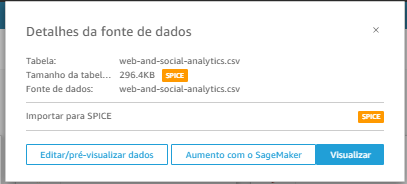
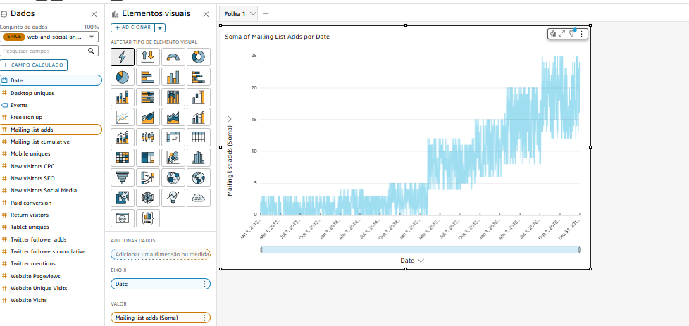
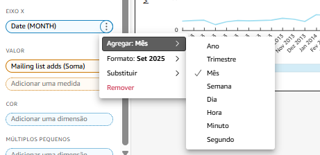
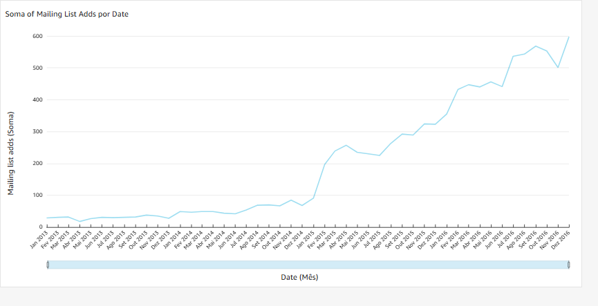
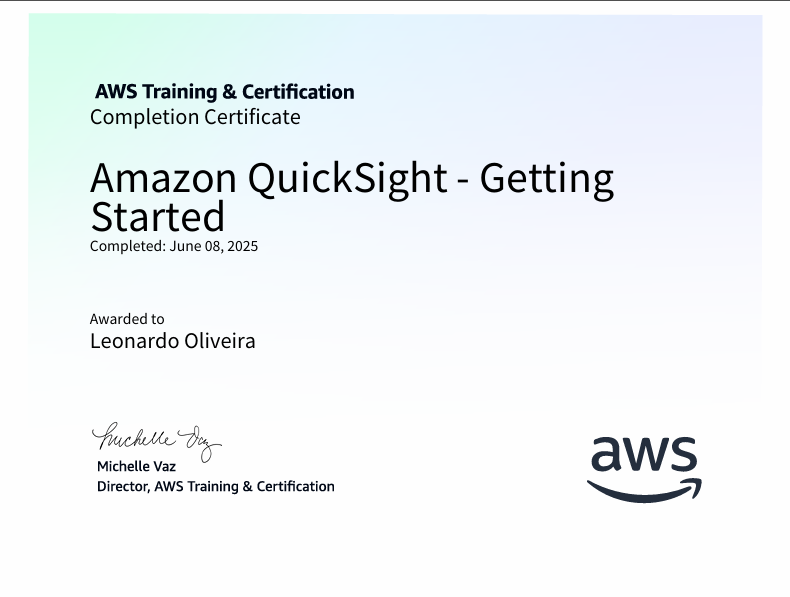

# Instrução  
Este arquivo registra meus estudos e experimentações na **Sprint 8 – Visualização de Dados com Amazon QuickSight**.  
Divido em: resumo conceitual, passo-a-passo do laboratório oficial e evidências de execução.  

---

# Resumo

### O que é o Amazon QuickSight?  
Amazon QuickSight é o serviço de _Business Intelligence_ da AWS. 100 % SaaS, permite:

* **Conectar** a diversas fontes (S3, Athena, Redshift, RDS, uploads CSV).  
* **Preparar** dados com _datasets_ em memória (SPICE) ou _direct query_.  
* **Visualizar** com mais de 20 tipos de gráficos, AutoGraph e narrativas em NLG.  
* **Compartilhar** dashboards escaláveis, com controles de segurança e _pay-per-session_.

Na Sprint 8 aprendi o fluxo completo **Fonte ➜ Dataset ➜ Visual ➜ Dashboard**, práticas de design _low-ink_ e agregações no painel *Field Wells*.

---

## 1. Laboratório “Web & Social Analytics”

### 1.1 Objetivo  
Importar o **web-and-social-analytics.csv** e construir um gráfico de linha que mostra *Mailing List Adds* agregados por **mês**.

### 1.2 Passos executados

| Etapa | Descrição |
|-------|-----------|
| 1 | Nova análise ▸ **Novo conjunto de dados** ▸ **Upload a file** (csv). |
| 2 | Tela *Visualize* detectou os tipos de coluna. |
| 3 | Selecionei **Date** + **Mailing list adds** → AutoGraph gerou linha diária. |
| 4 | Expandi **Field wells** ▸ no **X-axis** alterei **Aggregate → Month**. |
| 5 | Ajustei título, removi grade e apliquei paleta do tema escuro. |

### 1.3 Evidências

1.   
2.   
3.  
4.   

---

## 2. Link para o Desafio de Filmes e Séries  
> Veja detalhes no README específico: [Desafio › README](./Desafio/README.md)

---

## 3. Boas-práticas consolidadas

* **Agregações no Field Wells** evitam criar colunas extras ou alterar SQL.  
* **SPICE** reduz custo de Athena e melhora performance (~200 ms de latência).  
* **Tema único + 3 cores** garante consistência visual (_low-ink design_).  
* KPI → cartão simples, sem setas de tendência para evitar ruído.

---

## 4. Conclusão

A Sprint 8 me permitiu:

1. Dominar o upload de dados e criação de datasets no QuickSight.  
2. Entender como o AutoGraph sugere visual baseado nos campos.  
3. Refinar visuais via Field Wells (agregações, cor, tooltip).  
4. Publicar dashboards responsivos e prontos para compartilhamento seguro.

## 5. Certificados

---
